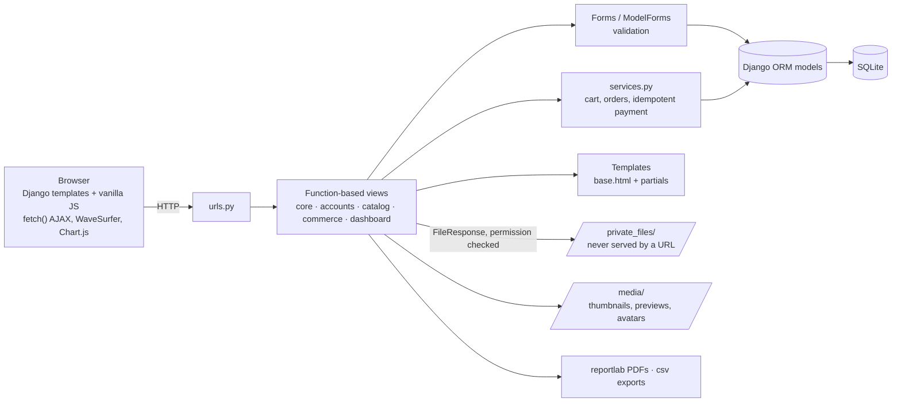

<p align="center">
  
</p>

<h1 align="center">Pixel Forge</h1>

<p align="center"><strong>A marketplace where indie game developers buy and sell sprites, tilesets, UI kits, 3D models, sound effects and music.</strong><br>
Preview everything in the browser, pay in rupees, download in seconds. Built with Python and Django.</p>

<p align="center">
  
  
  
  
  
</p>

> **Stack note.** This project began as a MERN app. Our course requires Python and Django, so it was rebuilt as a
> Django project that keeps the same product, design and data. The original code is preserved in [`legacy/`](legacy/)
> and every old page, endpoint and model field is mapped to its Django replacement in [`MIGRATION_MAP.md`](MIGRATION_MAP.md).
> How each syllabus topic is demonstrated is in [`SYLLABUS_MAP.md`](SYLLABUS_MAP.md).

## What it does

**For buyers**
- Explore with live filters: category, media type, price range, tags, rating, sort. Results update with AJAX and the URL stays shareable.
- Preview before buying: zoomable image viewer with a sprite-sheet animator, and a WaveSurfer waveform player for audio. Only one sound plays at a time across the whole site.
- Wishlist, cart, simulated "PixelPay" checkout (with a *simulate failure* button), order receipts as PDF, and a library with permission-checked downloads.
- A command palette (`Ctrl/Cmd + K`) with live results, recent searches and keyboard navigation.

**For creators**
- Five-step upload wizard with live preview, client and server validation, drag and drop, draft autosave and a real upload progress bar.
- Studio dashboard: earnings, sales and downloads over 7/30/90 days, sales by category, top assets, review feed.
- Sales report as CSV or PDF. Edit, archive and re-publish assets; see moderation reasons when an asset is rejected.

**For admins**
- Overview with platform revenue, fees, signups and a moderation queue.
- Ban or unban users (signs them out everywhere), change roles, approve, reject-with-reason, feature and archive assets.
- Monthly summary PDF and an orders CSV. Everything is also available in Django's own `/admin/`.

## Architecture



| App | Responsibility |
| --- | --- |
| `pixelforge` | Project settings and root URLconf |
| `core` | Home page, generated pixel art (Pillow), PDF helpers, error pages, demo-data command |
| `accounts` | Custom `User`, `CreatorProfile`, register/login/logout, settings, wishlist, public profiles |
| `catalog` | `Category`, `Tag`, `Asset`, `AssetPreview`, `Review`; explore, detail, search API, creator studio |
| `commerce` | `CartItem`, `Order`, `OrderItem`, `Purchase`; checkout, library, downloads, receipts |
| `dashboard` | Creator studio analytics, admin panel, CSV and PDF reports |

## Screenshots

| | |
| --- | --- |
|  |  |
|  |  |
|  |  |

*Screenshot files are placeholders. Run the app, capture these six pages and save them in `docs/screenshots/`.*

## Run it locally

You need Python 3.12 or newer. No Node, npm or database server.

```bash
python -m venv .venv
.venv\Scripts\activate          # macOS/Linux: source .venv/bin/activate
pip install -r requirements.txt
python manage.py migrate
python manage.py seed_demo      # 15 users, 49 assets, 112 paid orders, reviews
python manage.py runserver
```

Open http://127.0.0.1:8000/. Copy `.env.example` to `.env` if you want to change `SECRET_KEY`, `DEBUG` or `ALLOWED_HOSTS`.

### Demo accounts

All use the password `Password123`.

| Role | Username | Email |
| --- | --- | --- |
| Admin | `admin` | admin@pixelforge.dev |
| Creator | `mirapixel` | mirapixel@example.com |
| Buyer | `demo` | demo@example.com |

`python manage.py seed_demo --reset` wipes and regenerates the demo data. All art and audio are generated by code, so there are no binary assets in the repository.

### Tests

```bash
python manage.py test
```

Covers models and constraints, form validation, role-based access for anonymous/buyer/creator/admin, AJAX JSON endpoints, checkout idempotency and the failure/retry path, download permissions, and CSV/PDF responses.

## Design decisions worth explaining

- **Private downloads.** Paid files are stored in `private_files/`, outside `MEDIA_ROOT`. The storage class has no URL on purpose. The only way out is the `download` view, which checks purchase, ownership or admin role and guards against path traversal.
- **Payments are simulated.** No gateway, keys or SDK. `confirm_payment` runs in a transaction with `select_for_update`, so paying twice, or a late failure after success, changes nothing.
- **Fees come out of the creator's share.** Buyers pay the listed price. The platform keeps 10% (`PLATFORM_FEE_PERCENT`) and each order item records the creator's earning at sale time.
- **Progressive enhancement.** Every form and filter works without JavaScript. AJAX is layered on top and degrades to a normal page load.
- **No front-end build.** Templates, one CSS file and a few vanilla JS files. WaveSurfer, Chart.js, Lucide and fonts come from CDNs.

## Deployment notes

This is a lab project and runs with `DEBUG=1` locally. If you host it anywhere:

1. Set `DEBUG=0`, a long random `SECRET_KEY` and `ALLOWED_HOSTS`.
2. Run `python manage.py collectstatic` and serve `staticfiles/` plus `media/` from the web server. `private_files/` must never be exposed.
3. `python manage.py check --deploy` lists the remaining HTTPS settings (HSTS, secure cookies, SSL redirect) to switch on behind TLS.
4. Swap SQLite for PostgreSQL if you expect real traffic.

## Team

| Member | Contribution |
| --- | --- |
| **Abhishek** | Authentication, users and roles, core utilities (original Express modules ported to `accounts` and `core`) |
| **Parth** | Catalog, search and filters, upload, reviews and ratings (ported to `catalog`) |
| **Adwait** | Cart, orders, simulated payments, library, downloads, creator analytics, admin, seeding (ported to `commerce`, `dashboard`, `seed_demo`) |
| **Naman** | Front-end design system and every page, the Django rewrite, project integration |

## What we learned

- A relational model forces honesty. Moving from MongoDB documents to Django models made us decide what a purchase, an order and an order item each really are.
- Server-rendered pages plus a little `fetch()` go a long way. Most "app-like" behaviour needed far less JavaScript than we first assumed.
- Idempotency is a feature, not an edge case. The payment flow got simpler once every step was safe to repeat.
- Tests that assert *who is refused* catch more real bugs than tests that assert success.
- Migrating a project is mostly mapping: writing `MIGRATION_MAP.md` first made the rewrite predictable.

## Repository layout

```text
pixelforge/   project settings, urls
core/ accounts/ catalog/ commerce/ dashboard/   Django apps
templates/    base.html, partials, 403/404/500
static/       css/pixelforge.css, js/*.js, img/
media/        generated at runtime (thumbnails, previews, avatars)
private_files/ paid downloads, never served by a URL
legacy/       the original MERN client and server, kept for reference
```
