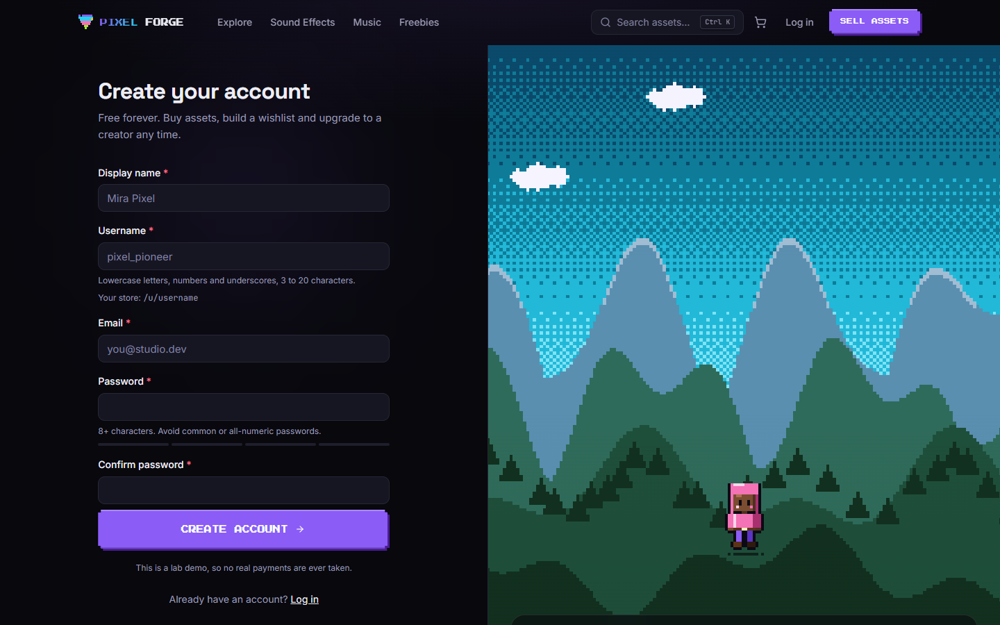
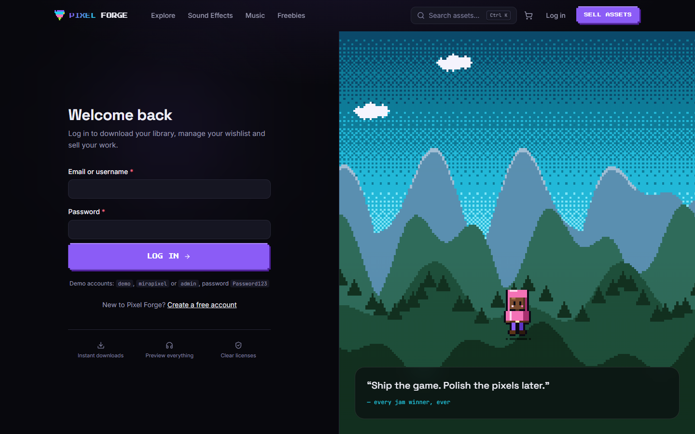
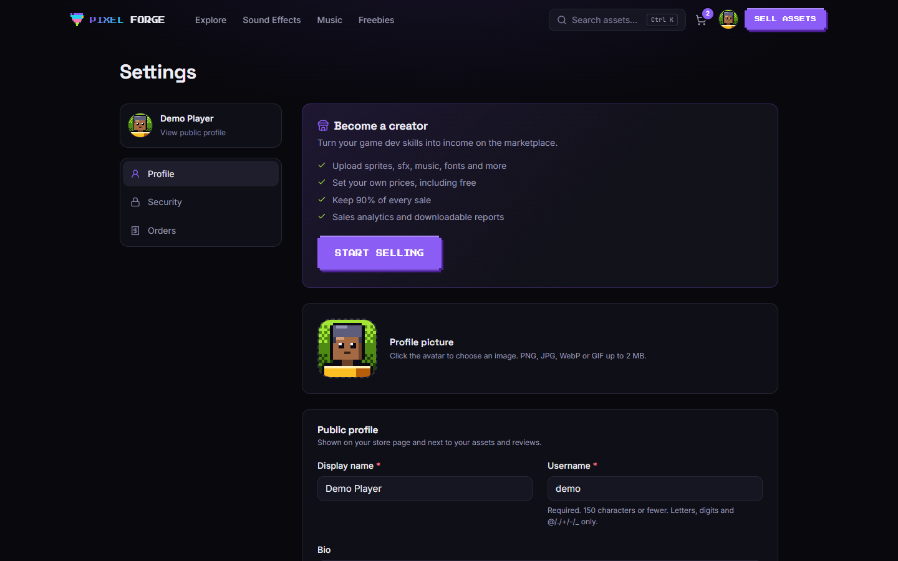
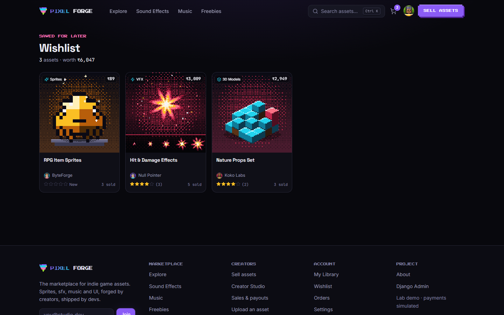
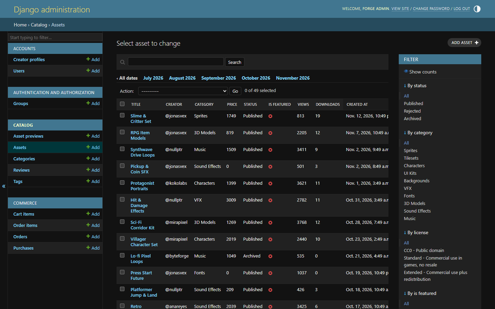

# Study Guide 1: Abhishek — Project Foundation, Login and Users

> Read this top to bottom once. Then read the **Questions and Answers** part again before the viva.
> Every code snippet here is real and comes from the project. File paths are from the project root.

---

## 1. The project in 5 lines (everyone must know this)

- **Pixel Forge** is a website where game developers **buy and sell game assets** (sprites, sounds, music, 3D models).
- It is built with **Python 3 + Django 5.2** and a **SQLite** database. No React, no Node.
- There are **three kinds of users**: *buyer*, *creator* (seller) and *admin*.
- The project is split into five Django **apps**: `core`, `accounts`, `catalog`, `commerce`, `dashboard`.
- Payment is **simulated** (a fake card page). No real money moves.

| Person | Owns |
|---|---|
| **Abhishek** | Project setup, settings, URLs, login/register, users and roles, wishlist, profiles, security |
| Parth | The catalogue: assets, search, filters, reviews, upload (creator studio) |
| Adwait | Cart, orders, payment, downloads, dashboards, reports, demo data |
| Naman | Everything you see: templates, CSS, JavaScript, design, pixel art |

**You own the base of the whole project.** Every other part stands on the user model and login system you built.

---

## 2. What you built (your part)

1. The **Django project** itself: `pixelforge/settings.py`, `pixelforge/urls.py`, `manage.py`.
2. The **`accounts` app**: custom `User` model, `CreatorProfile`, register, login, logout, settings page, change password, become-a-creator, public profile, wishlist.
3. **Security and roles**: password rules, CSRF, sessions, `login_required`, role decorators, banned users, safe redirects.
4. **Shared plumbing**: the *context processor* (`core/context_processors.py`) that gives every page the cart count and wishlist, and the custom **403 / 404 / 500 error handlers** in `core/views.py`.
5. The **Django Admin** setup for users (`accounts/admin.py`).
6. Tests for all of this: `accounts/tests.py`.

### Your files

| File | What it does |
|---|---|
| `manage.py` | Django's command tool (`runserver`, `migrate`, `test`) |
| `pixelforge/settings.py` | All configuration |
| `pixelforge/urls.py` | The main URL list. It includes each app's own `urls.py` |
| `accounts/models.py` | `User` and `CreatorProfile` |
| `accounts/forms.py` | `RegisterForm`, `LoginForm`, `ProfileForm`, `StyledPasswordChangeForm` |
| `accounts/views.py` | register, login view, settings, become_creator, profile, wishlist, wishlist_toggle |
| `accounts/urls.py` | The URLs of the accounts app |
| `accounts/decorators.py` | `role_required`, `creator_required`, `admin_required` |
| `accounts/admin.py` | How users appear in `/admin/` |
| `core/context_processors.py` | Data available in every template |
| `core/views.py` (bottom part) | `handler403`, `handler404`, `handler500` |
| `accounts/tests.py` | 12 automated tests |

---

## 3. How a request travels (the architecture)

This is Django's **MVT** pattern (Model – View – Template). Learn this picture:

```
Browser  --URL-->  urls.py  -->  view (a Python function)
                                   |-- uses a Form to check input
                                   |-- uses Models to read/write the database (SQLite)
                                   '-- renders a Template (HTML) and sends it back
```

Between the browser and the view there is **middleware** (set in `settings.py`). Each one does one job on every request:

| Middleware | Job |
|---|---|
| `SecurityMiddleware` | Adds security headers |
| `SessionMiddleware` | Reads the session cookie so we know who this browser is |
| `CsrfViewMiddleware` | Blocks forged form posts |
| `AuthenticationMiddleware` | Puts the logged-in user in `request.user` |
| `MessageMiddleware` | Lets us show one-time messages ("Profile saved") |
| `XFrameOptionsMiddleware` | Stops other sites putting ours in an iframe |

**Simple words:** the browser sends a request, Django passes it through these helpers, finds the right function by URL, the function does the work and returns HTML.

---

## 4. Concepts in simple language

**Django app** — a folder that does one job. `accounts` handles people. `catalog` handles assets.

**Model** — a Python class that becomes a database table. Each attribute is a column.

**Migration** — a file that tells the database how to build or change a table. `makemigrations` writes it, `migrate` applies it.

**View** — a function that receives a request and returns a response.

**Form / ModelForm** — a class that checks what the user typed. A `ModelForm` builds the form from a model automatically.

**Template** — an HTML file with Django tags such as `` and `{{ name }}`.

**Session** — Django remembers a logged-in user with a cookie that holds a random session id. The real data stays on the server.

**CSRF token** — a secret value hidden in every POST form. If it is missing or wrong, Django refuses the request. It stops other websites from submitting forms for you.

**Password hashing** — Django never stores your password. It stores a *hash* (a one-way scramble). On login it hashes what you typed and compares.

**Decorator** — a line like `@login_required` placed above a function that adds a check before the function runs.

**Context processor** — a function whose result is added to every template automatically.

---

## 5. Code walk-through

### 5.1 The custom User model — `accounts/models.py`

Django already has a `User`. We **extended** it with `AbstractUser` so we can add our own fields.

```python
class User(AbstractUser):
    ROLE_BUYER = 'buyer'
    ROLE_CREATOR = 'creator'
    ROLE_ADMIN = 'admin'
    email = models.EmailField('email address', unique=True)
    role = models.CharField(max_length=10, choices=ROLE_CHOICES, default=ROLE_BUYER, db_index=True)
    bio = models.CharField(max_length=300, blank=True)
    avatar = models.ImageField(upload_to='avatars/', blank=True)
    ...
    wishlist = models.ManyToManyField('catalog.Asset', related_name='wishlisted_by', blank=True)
```

Explain it like this:
- `role` decides what the person can do. Default is `buyer`.
- `email` is **unique** so two accounts cannot share an email.
- `wishlist` is a **many-to-many** link: one user saves many assets and one asset is saved by many users. Django makes a hidden third table for it.
- In `settings.py` we tell Django to use it: `AUTH_USER_MODEL = 'accounts.User'`. **This must be set before the first migration.**

Useful helpers on the model (called *properties*):
- `display_name` — first name, or the username if there is no first name.
- `is_creator` — true for creators **and** admins.
- `is_admin_role` — true only for admins.
- `is_banned` — true when `is_active` is false.
- `avatar_url` — the uploaded picture, or a generated pixel avatar if none.

`save()` is overridden for two small rules: a superuser always gets `role = admin`, and email is stored in lowercase.

### 5.2 `CreatorProfile` — one-to-one

```python
class CreatorProfile(models.Model):
    user = models.OneToOneField(User, on_delete=models.CASCADE, related_name='creator_profile')
    tagline = models.CharField(max_length=120, blank=True)
    banner_seed = models.CharField(max_length=60, blank=True)
```

A **one-to-one** link: one user has at most one creator profile. It is created the moment a buyer clicks "become a creator". `related_name='creator_profile'` lets us write `user.creator_profile`.

Relationship types in your app (a favourite teacher topic):

| Type | Where |
|---|---|
| One-to-one | `CreatorProfile.user` → `User` |
| Many-to-many | `User.wishlist` ↔ `Asset` |
| One-to-many (foreign key) | other apps point at `User` (assets, orders, reviews) |

### 5.3 Register — `accounts/forms.py` and `views.py`

`RegisterForm` extends Django's `UserCreationForm`. It adds *display name* and *email*, and checks:
- username: 3–20 characters, lowercase letters, numbers, underscore, and not already taken;
- email: not already registered (`clean_email`);
- password: the four validators in `settings.py` (min 8 characters, not too common, not all digits, not too similar to the username).

The view:

```python
def register(request):
    form = RegisterForm(request.POST or None)
    if request.method == 'POST' and form.is_valid():
        user = form.save()
        login(request, user)          # log them in straight away
        messages.success(request, 'Welcome to the forge, ...')
        return redirect(...)
```

- `request.POST or None` means: on a normal page visit the form is empty; on submit it is filled.
- After saving, the user is logged in immediately.
- If the link had `?intent=sell`, they are sent to the home page with `?become=1`, which opens the "become a creator" popup.

### 5.4 Login with email OR username — `LoginForm`

Django's default login only accepts a username. We subclass `AuthenticationForm` and override `clean()`:

```python
user = (User.objects.filter(email__iexact=identifier).first() if '@' in identifier
        else User.objects.filter(username__iexact=identifier).first())
if user and not user.is_active and user.check_password(password):
    raise ValidationError('This account has been banned.')
self.user_cache = authenticate(self.request, username=user.username if user else identifier, password=password)
```

Idea: if the text has `@` we look the user up by email, otherwise by username. Then we call Django's normal `authenticate`. A banned user with the *correct* password gets a clear "banned" message instead of a vague error.

The view is Django's own `LoginView` with a small subclass (`PixelLoginView`) that sets our template and adds a welcome message. Logout is Django's `LogoutView` and works **only with POST** (a GET returns error 405) so another site cannot log you out with an image tag.

### 5.5 Roles and access control — `accounts/decorators.py`

```python
def role_required(*roles):
    def decorator(view):
        @wraps(view)
        @login_required
        def wrapper(request, *args, **kwargs):
            if request.user.role not in roles:
                raise PermissionDenied
            return view(request, *args, **kwargs)
        return wrapper
    return decorator

creator_required = role_required('creator', 'admin')
admin_required = role_required('admin')
```

- Not logged in → sent to the login page (that is `@login_required`).
- Logged in with the wrong role → `PermissionDenied` → our styled **403 page**.
- Used by Parth's studio views and Adwait's dashboards: `@creator_required`, `@admin_required`.

### 5.6 Settings page — `settings_view`

One page, three tabs: **profile**, **security** (change password), **orders**. The hidden field `form_name` tells the view which form was submitted.

```python
user = password_form.save()
update_session_auth_hash(request, user)   # stay logged in after changing password
```

Without `update_session_auth_hash`, changing the password would log you out, because the session is tied to the password hash.

`ProfileForm` is a **ModelForm** over `User`. It checks the username again (excluding yourself so you can keep your own name) and the avatar (must be an image, under 2 MB).

### 5.7 Become a creator, profile, wishlist

- `become_creator` (POST only): changes `role` from buyer to creator and creates the `CreatorProfile` with `get_or_create`. Calling it twice is safe.
- `profile` (`/u/<username>/`): public page. It only shows **published** assets and uses `aggregate()` to calculate asset count, sales, downloads and average rating.
- `wishlist_toggle`: if the asset is already in the wishlist it is removed, otherwise added. If the request came from JavaScript (header `X-Requested-With: XMLHttpRequest`) it returns **JSON** like `{"ok": true, "in_wishlist": true}`; otherwise it redirects. So the heart button works even with JavaScript turned off.

### 5.8 Safe redirects — `_safe_next`

After login, the URL may contain `?next=/somewhere/`. If we trusted any value, an attacker could send you to a bad site. `url_has_allowed_host_and_scheme` only allows redirects to **our own host**. This prevents an *open redirect* attack.

### 5.9 Context processor — `core/context_processors.py`

Runs for every page and adds: `cart_count`, `wishlist_ids`, `owned_ids`, `nav_active`, `SITE_NAME`, `PLATFORM_FEE_PERCENT`.

Why it matters: the navbar cart badge and the filled-in hearts on asset cards need this on *every* page. Doing it once here avoids repeating code in every view. It is registered in `settings.py` under `TEMPLATES → context_processors`.

### 5.10 Error pages — `core/views.py`

```python
def handler403(request, exception=None): return render(request, '403.html', status=403)
def handler404(request, exception=None): return render(request, '404.html', status=404)
def handler500(request): return render(request, '500.html', status=500)
```

They are connected in `pixelforge/urls.py` with `handler403 = 'core.views.handler403'` etc. **Note:** Django shows its own yellow debug page while `DEBUG = True`. Our pages appear when `DEBUG = False`.

### 5.11 Settings that matter — `pixelforge/settings.py`

| Setting | Meaning |
|---|---|
| `SECRET_KEY`, `DEBUG`, `ALLOWED_HOSTS` | Read from environment variables with safe defaults for development |
| `AUTH_USER_MODEL = 'accounts.User'` | Use our user model |
| `AUTH_PASSWORD_VALIDATORS` | Four password rules |
| `LOGIN_URL = 'accounts:login'` | Where `@login_required` sends visitors |
| `TIME_ZONE = 'Asia/Kolkata'` | Indian time |
| `MEDIA_ROOT` | Folder for public uploads (avatars, thumbnails) |
| `PRIVATE_FILES_ROOT` | Folder for paid files. **No URL ever serves it** |
| `PLATFORM_FEE_PERCENT = 10` | Platform keeps 10% (used by Adwait's code) |
| `if not DEBUG:` block | Turns on secure cookies, SSL redirect and HSTS for production |

---

## 6. How to demo your part (60 seconds)

1. Open `/accounts/register/` → create an account → you are logged in. 

   

2. Log out, log in using the **email** this time (login accepts both).

   

3. Open `/settings/` → change the bio, then open the **Security** tab and change the password.

   

4. Click the heart on an asset → open `/wishlist/`.

   

5. Try `/panel/` as a buyer → you see the **403** page. Log in as `admin` (password `Password123`) → it opens.
6. Open `/admin/` (Django Admin) → show the Users table with role filter.

   

7. Run the tests: `python manage.py test accounts` → all pass.

---

## 7. Questions and Answers

### Basics

**Q1. What is Django?**
A Python web framework. It gives you URL routing, an ORM for the database, templates, forms, login, an admin site and security features, so we write less code.

**Q2. What is MVT? How is it different from MVC?**
MVT = Model, View, Template. Model is the data (database table). View is the Python function with the logic. Template is the HTML. It is the same idea as MVC, but Django calls the controller a *view* and the HTML a *template*; Django's own URL system plays the controller's routing role.

**Q3. What is the difference between a project and an app?**
The project (`pixelforge`) is the whole website and its settings. An app is one feature module (`accounts`, `catalog`...). One project has many apps, and an app can be reused in another project.

**Q4. What do `makemigrations` and `migrate` do?**
`makemigrations` looks at the models and writes a migration file describing changes. `migrate` runs those files and changes the real database.

**Q5. Why SQLite?**
It needs no installation, the database is one file (`db.sqlite3`), and it is enough for a lab project. In production we would move to PostgreSQL by changing the `DATABASES` setting.

**Q6. What is `manage.py`?**
A small script that runs Django commands for this project: `runserver`, `migrate`, `test`, `createsuperuser`, `seed_demo`.

### Users and login

**Q7. Why did you create a custom user model?**
We needed extra fields (role, bio, avatar, wishlist). Django advises doing this at the very start of a project because changing the user model later is painful. We extended `AbstractUser`, so we keep all built-in features (passwords, permissions, admin).

**Q8. What is `AUTH_USER_MODEL`?**
A setting that tells Django which model is the user. Other apps refer to it with `settings.AUTH_USER_MODEL` instead of importing `User` directly.

**Q9. How are passwords stored?**
As hashes (PBKDF2 by default), never as plain text. Even we cannot read a user's password.

**Q10. How does login work internally?**
`authenticate()` checks username and password. `login()` stores the user's id in the session. The browser gets a session cookie. On each request `AuthenticationMiddleware` reads the session and sets `request.user`.

**Q11. What is a session?**
Server-side storage linked to the browser by a random id in a cookie. We use Django's database sessions (the `django_session` table).

**Q12. How does login by email work if Django wants a username?**
`LoginForm.clean()` looks up the user by email (if the text has `@`) or by username, then passes the real username to `authenticate()`.

**Q13. Why is logout POST only?**
A GET logout can be triggered by any image or link on another site (logout CSRF). POST with a CSRF token cannot.

**Q14. What happens if a banned user tries to log in?**
Banning sets `is_active = False`. `LoginForm` detects a correct password on an inactive account and shows "This account has been banned."

**Q15. What does `@login_required` do?**
If the user is not logged in it redirects to `LOGIN_URL` and adds `?next=` so the user returns to the page afterwards.

**Q16. How do you separate buyer, creator and admin?**
The `role` field plus `role_required` decorators. Wrong role → 403 page.

**Q17. Difference between authentication and authorization?**
Authentication = who are you (login). Authorization = what are you allowed to do (roles/permissions).

**Q18. Why `update_session_auth_hash` after a password change?**
Django ties the session to the password hash. Changing the password would invalidate the session and log the user out. This call refreshes the hash in the session so they stay logged in.

### Security

**Q19. What is CSRF and how do you prevent it?**
Cross-Site Request Forgery: another site makes your browser send a form to ours while you are logged in. Every POST form has ``. Django rejects POSTs without a matching token. For `fetch()` calls our JavaScript sends the token in the `X-CSRFToken` header.

**Q20. What is an open redirect and how did you stop it?**
Using `?next=https://evil.com` to bounce users to a bad site. `_safe_next` allows only URLs on our own host (`url_has_allowed_host_and_scheme`).

**Q21. How does Django protect against SQL injection and XSS?**
The ORM builds parameterised queries, so user input is never glued into SQL. Templates auto-escape HTML, so `<script>` typed by a user is shown as text.

**Q22. What do the `if not DEBUG` settings do?**
In production they force secure cookies, redirect HTTP to HTTPS and enable HSTS. `python manage.py check --deploy` lists what is still missing in development.

**Q23. Why keep `SECRET_KEY` in environment variables?**
It signs sessions and tokens. If it leaks anyone can forge them. It must not be in Git. `.env.example` shows the variables without real values.

### Models and relationships

**Q24. Explain one-to-one, one-to-many and many-to-many with examples from your app.**
One-to-one: `User` ↔ `CreatorProfile`. One-to-many: one `User` has many assets/orders (foreign key on the other side). Many-to-many: `User.wishlist` ↔ `Asset`.

**Q25. What does `related_name` do?**
It names the reverse link. `related_name='creator_profile'` gives `user.creator_profile`. `related_name='wishlisted_by'` gives `asset.wishlisted_by.all()`.

**Q26. What does `on_delete=models.CASCADE` mean?**
If the user is deleted, the linked profile is deleted too.

**Q27. What is `unique=True` on email for?**
The database refuses two users with the same email. We also lowercase emails on save and check in the form for a friendly message.

**Q28. What is `db_index=True` on `role`?**
It builds a database index so filtering users by role (admin panel) is fast.

### Forms, views, URLs

**Q29. Form vs ModelForm?**
A Form is written by hand. A ModelForm builds fields from a model and can `save()` straight to the database. `ProfileForm` is a ModelForm; `ExploreForm` (Parth) is a plain Form.

**Q30. What are `clean_<field>` and `clean()`?**
`clean_username()` checks a single field. `clean()` checks several fields together. Both raise `ValidationError` to show an error message.

**Q31. Why `request.POST or None`?**
So one view serves both GET (empty form) and POST (form with data), and errors show next to fields.

**Q32. What is the `messages` framework?**
One-time notices such as "Profile saved". They are stored in the session and shown once. Naman's JavaScript turns them into toast popups.

**Q33. How do URLs work with `include()` and namespaces?**
`pixelforge/urls.py` includes each app's `urls.py`. Each app sets `app_name`, so we write ``. Names never clash between apps.

**Q34. What is `get_object_or_404`?**
It fetches one object or raises a 404 page. Used for profiles and assets.

**Q35. Why function-based views?**
They are simple to read and the lab requires them. We use Django's class-based `LoginView` and `LogoutView` only because they are built in.

### Wishlist and JSON

**Q36. How does the wishlist heart work without a page reload?**
JavaScript posts with `fetch()` and the header `X-Requested-With`. The view sees that header and returns JSON. Without JavaScript the same form posts normally and the view redirects.

**Q37. What is `JsonResponse`?**
A Django response that turns a Python dictionary into JSON for AJAX code.

### Admin and errors

**Q38. What is the Django Admin?**
An automatic management site at `/admin/`. We registered users with filters, search and a creator-profile inline.

**Q39. Why do you have `handler404`?**
To show our own friendly page (with a small game, by Naman) instead of Django's default.

**Q40. What is a context processor and why use one?**
A function whose returned dictionary is added to every template. We use it for the cart count and wishlist so we do not repeat that code in every view.

### Testing

**Q41. What tests did you write?**
Register works, duplicate email rejected, weak password rejected, password mismatch rejected, login by email and by username, wrong password, banned user cannot log in, logout needs POST, become creator, superuser gets admin role, settings needs login, wishlist toggle returns JSON.

**Q42. How do you run them?**
`python manage.py test accounts` (or `python manage.py test` for all 75 tests). Django makes a temporary empty database for tests.

---

## 8. Tricky questions the teacher may ask

- **"Show me where the password is stored."** → Open `db.sqlite3` or Django Admin: it shows `pbkdf2_sha256$...` — a hash.
- **"What if two users register with `Ali@x.com` and `ali@x.com`?"** → We lowercase the email and check case-insensitively (`email__iexact`), so the second one is rejected.
- **"Can a buyer open the studio by typing the URL?"** → No. `@creator_required` raises 403.
- **"What if I remove ``?"** → Django returns 403 "CSRF verification failed".
- **"Why not store the role in a separate table?"** → One value per user, read on every request; a column is simpler and faster.
- **"Where is the session saved?"** → In the `django_session` table; the cookie only has the id.

---

## 9. One-page cheat sheet

- Stack: Python, Django 5.2, SQLite, sessions, ModelForms, function-based views.
- My files: `settings.py`, `urls.py`, `accounts/*`, `core/context_processors.py`, error handlers.
- Relationships: 1-1 CreatorProfile, M2M wishlist, FK from other apps.
- Security: password hashing, CSRF, sessions, role decorators, safe redirects, secure cookies when `DEBUG=False`.
- Demo accounts: `admin`, `mirapixel` (creator), `demo` (buyer). Password for all: `Password123`.
- Run: `python manage.py runserver`. Test: `python manage.py test accounts`.
