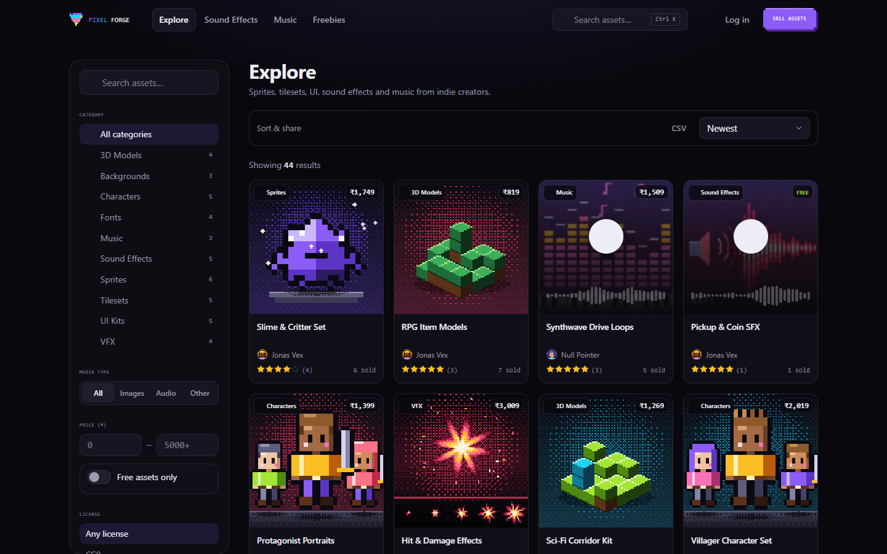
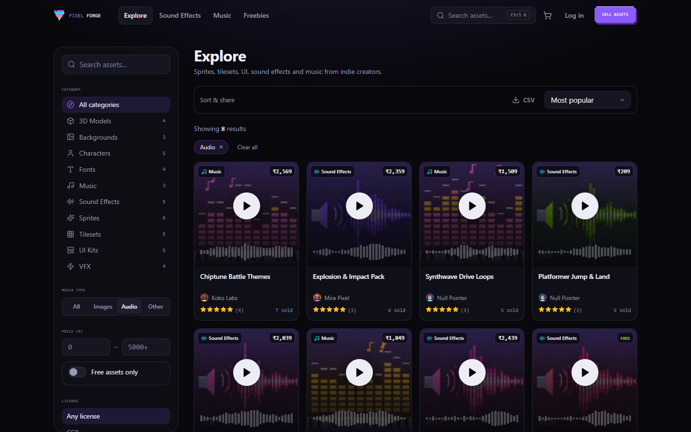
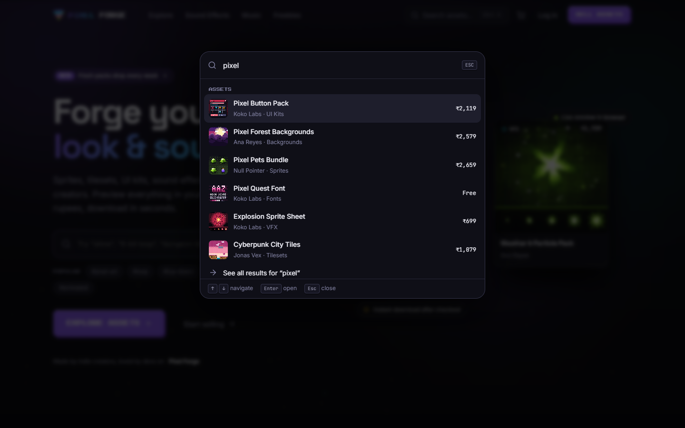
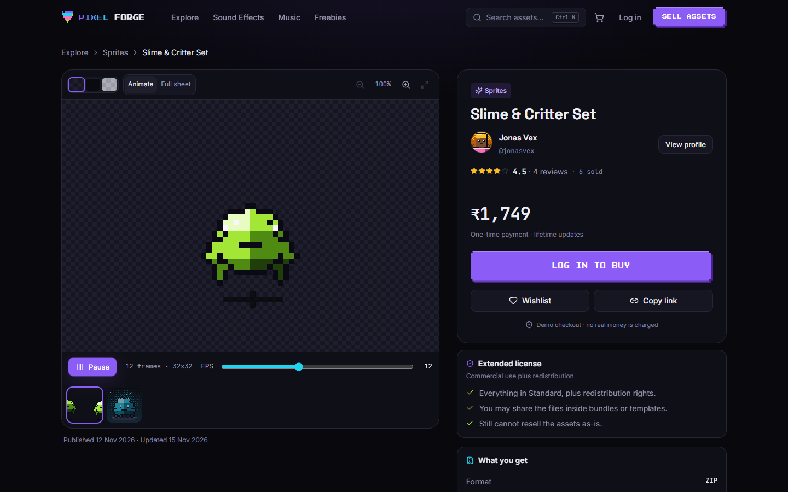
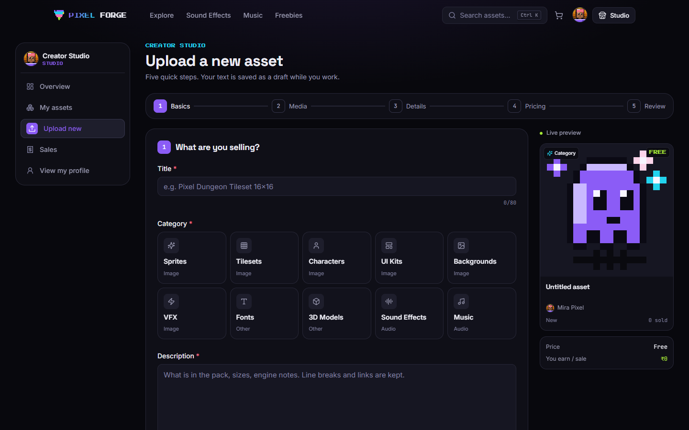
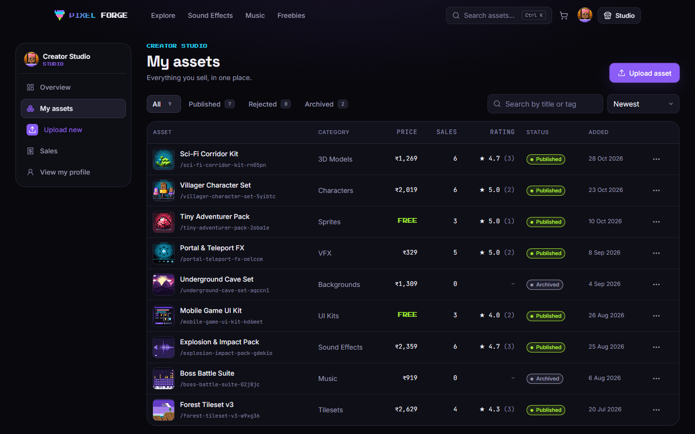

# Study Guide 2: Parth — Assets, Search, Reviews and Creator Studio Upload

> Read this top to bottom once. Then read the **Questions and Answers** part again before the viva.
> Every code snippet here is real and comes from the project. File paths are from the project root.

---

## 1. The project in 5 lines (everyone must know this)

- **Pixel Forge** is a website where game developers **buy and sell game assets** (sprites, sounds, music, 3D models).
- It is built with **Python 3 + Django 5.2** and a **SQLite** database. No React, no Node.
- There are **three kinds of users**: *buyer*, *creator* (seller) and *admin*.
- The project is split into five Django **apps**: `core`, `accounts`, `catalog`, `commerce`, `dashboard`.
- Payment is **simulated** (a fake card page). No real money moves.

| Person | Owns |
|---|---|
| Abhishek | Project setup, settings, URLs, login/register, users and roles |
| **Parth** | The catalogue: assets, categories, tags, search, filters, reviews, upload (creator studio) |
| Adwait | Cart, orders, payment, downloads, dashboards, reports, demo data |
| Naman | Everything you see: templates, CSS, JavaScript, design, pixel art |

**You own the heart of the product:** the things that are sold, how people find them, and how creators add them.

---

## 2. What you built (your part)

1. The **`catalog` app** database models: `Category`, `Tag`, `Asset`, `AssetPreview`, `Review`.
2. A **custom QuerySet** (`AssetQuerySet`) with reusable query methods: `published()`, `with_stats()`, `for_cards()`, `search()`, `with_tags()`.
3. **Explore page**: search, filters (category, tags, price, free, license, media type), sorting, pagination, removable filter chips, CSV export.
4. **JSON search API** (`/api/search/`) used by the Ctrl+K search box.
5. **Asset detail page**: previews, rating summary, related assets, view counter.
6. **Reviews**: add / edit / delete, one per buyer, only owners can review.
7. **Creator studio**: upload a new asset, edit, archive — with strong file validation.
8. **Private file storage** class so paid files can never be reached by a URL.
9. **Django Admin** for catalogue models and the data migration that creates the 10 categories.
10. Tests: `catalog/tests.py` (21 tests).

### Your files

| File | What it does |
|---|---|
| `catalog/models.py` | All catalogue models, the QuerySet, `PrivateFileStorage` |
| `catalog/forms.py` | `ExploreForm`, `ReviewForm`, `AssetForm` (the big one), `MultipleFileField` |
| `catalog/views.py` | explore, explore_csv, api_search, asset_detail, review_save/delete, studio_assets/new/edit/archive |
| `catalog/urls.py` | URLs of the app |
| `catalog/admin.py` | Admin screens |
| `catalog/migrations/0001_initial.py` | Creates the tables |
| `catalog/migrations/0002_seed_categories.py` | **Data migration**: inserts the 10 categories |
| `catalog/tests.py` | 21 tests |

---

## 3. Architecture of your part

```
                        /explore/?q=pixel&category=sprites&sort=popular
 Browser  ------------------------------------------------------------>  explore()  view
                                                                          |
                                           ExploreForm validates the URL query (GET)
                                                                          |
                          filtered_assets(): Asset.objects.published().for_cards().search(q)...
                                                                          |
                               Paginator (24 per page)  -->  template (full page or only the grid)
```

- **Normal request** → full HTML page.
- **AJAX request** (the filter panel uses `fetch`) → the same view returns only the small partial template `_results.html`.
- The URL always holds the filters, so a result page can be shared or bookmarked.

### Database picture (ER diagram in words)

```
Category 1 ----- * Asset * ----- * Tag          (Asset.tags  = many-to-many)
User     1 ----- * Asset                        (Asset.creator = foreign key)
Asset    1 ----- * AssetPreview                 (up to 6 per asset)
Asset    1 ----- * Review * ----- 1 User        (one review per user per asset)
```

---

## 4. Concepts in simple language

**QuerySet** — a lazy list of database rows. `Asset.objects.filter(price=0)` does not hit the database until you use it. You can chain filters.

**Custom QuerySet / manager** — we add our own methods (`published()`, `search()`) so every view can write `Asset.objects.published().search('dragon')` instead of repeating the logic.

**Annotation** — adds a calculated column to each row, e.g. number of sales, in the same query.

**Aggregation** — one calculation over many rows (`Avg`, `Count`, `Sum`).

**`select_related` / `prefetch_related`** — load related rows together to avoid the "N+1 queries" problem (one query per card).

**Slug** — a URL-friendly name like `slime-critter-set-5qq6ok`. Used instead of numeric ids in URLs.

**Pagination** — splitting long lists into pages. We use Django's `Paginator` (24 per page).

**Validation** — checking data before saving. Three layers here: model field validators, form `clean_<field>` methods, and view-level checks.

**FileField / ImageField** — fields that store an uploaded file on disk and the *path* in the database. `ImageField` needs the **Pillow** library.

**Data migration** — a migration that inserts data (our 10 categories), not just tables.

---

## 5. Code walk-through

### 5.1 `Asset` model — `catalog/models.py`

The main table. Important fields:

```python
creator   = models.ForeignKey(settings.AUTH_USER_MODEL, on_delete=models.CASCADE, related_name='assets')
category  = models.ForeignKey(Category, on_delete=models.PROTECT, related_name='assets')
tags      = models.ManyToManyField(Tag, blank=True, related_name='assets')
price     = models.PositiveIntegerField(default=0, validators=[MaxValueValidator(50000)])
thumbnail = models.ImageField(upload_to='thumbnails/')
file      = models.FileField(storage=get_private_storage, upload_to='files/')
status    = models.CharField(max_length=10, choices=STATUS_CHOICES, default='published')
```

Explain:
- `creator` — **foreign key** (one-to-many): a creator has many assets.
- `category` uses `PROTECT`: you cannot delete a category that still has assets.
- `tags` — **many-to-many**: an asset has many tags, a tag belongs to many assets.
- `price` is a whole number of **rupees**; `0` means free. Max ₹50,000.
- `thumbnail` is **public** (`media/thumbnails/`). `file` is the **paid product** stored in the **private** folder.
- `status`: `published`, `rejected`, `archived`. Only `published` assets are visible in the shop.
- Indexes on `(status, category)`, `price`, `created_at` make the Explore page fast.

`save()` creates a **unique slug**: the title in URL form plus 6 random characters, retrying until no other asset has it.

`clean()` checks title length (3–80), description (20–5000), frames ≥ 1, and clears the rejection reason when the asset is not rejected.

Handy properties: `is_free`, `media_kind` (image / audio / other, from the category), `tag_list`, `file_ext`, `file_size`, `audio_previews`, `image_previews`, `sales`, `rating`, `review_count`.

### 5.2 `PrivateFileStorage` — files with no URL

```python
class PrivateFileStorage(FileSystemStorage):
    @property
    def base_location(self):
        return str(settings.PRIVATE_FILES_ROOT)
    def url(self, name):
        raise ValueError('Private files have no public URL. Use the download view.')
```

- The paid file is saved under `private_files/`, which is **outside** `MEDIA_ROOT` and not mapped to any URL.
- `url()` deliberately raises an error: if anyone writes `asset.file.url` in a template, it fails loudly instead of leaking a link.
- The only way to get the file is Adwait's `download` view, which checks that you bought it.

### 5.3 The custom QuerySet

```python
class AssetQuerySet(models.QuerySet):
    def published(self):
        return self.filter(status=Asset.STATUS_PUBLISHED)

    def search(self, q):
        tagged = Asset.tags.through.objects.filter(tag__name__icontains=q).values('asset_id')
        return self.filter(Q(title__icontains=q) | Q(description__icontains=q) | Q(pk__in=tagged))

    def with_tags(self, names):      # must have ALL given tags
        qs = self
        for name in names:
            qs = qs.filter(pk__in=Asset.tags.through.objects.filter(tag__name=name).values('asset_id'))
        return qs
```

- `published()` — only public assets.
- `search()` — matches title, description, or any tag (`icontains` = case-insensitive "contains"). `Q(...) | Q(...)` means OR.
- Tag matching uses a **subquery** (`pk__in=...`). This avoids duplicate rows that a join would create when an asset has several matching tags.
- `with_tags()` — "has all of these tags": one filter per tag.
- `with_stats()` / `for_cards()` add `n_sales`, `n_reviews`, `avg_rating`, `n_wishlists` with `Count(..., distinct=True)` and `Avg` so each card shows its numbers from **one query**.

### 5.4 Explore — `ExploreForm` + `filtered_assets` + `explore`

`ExploreForm` is a plain **Form** that reads `request.GET`. Fields: `q`, `category`, `tags`, `min_price`, `max_price`, `free`, `license`, `media_kind`, `sort`.

Small but smart rules inside `clean()`:
- if min price > max price, they are swapped;
- sort by "relevance" is only allowed when there is a search term.

`filtered_assets(form)` applies each filter only if it was given, then sorts:

```python
qs = Asset.objects.published().for_cards().search(data.get('q'))
if data.get('category'):  qs = qs.filter(category=data['category'])
if data.get('free'):      qs = qs.filter(price=0)
if data.get('min_price') is not None: qs = qs.filter(price__gte=data['min_price'])
...
```

Sorting options: newest, popular (most sales), top rated, price low→high, price high→low, and best match (title starts with the search word → title contains → rest).

The `explore` view: validates, filters, paginates with `Paginator(qs, 24)`, and — if the request is AJAX — returns only `catalog/_results.html`.

`active_chips()` builds the removable filter chips ("Sprites ✕", "Free only ✕"). Each chip's link is the current URL **minus that one filter**.





### 5.5 JSON search API — `api_search`

```python
def api_search(request):
    q = request.GET.get('q', '').strip()
    if not q:
        return JsonResponse({'q': q, 'results': []})
    ...
    return JsonResponse({'q': q, 'results': [{'title': a.title, 'slug': a.slug, 'url': ..., 'thumbnail': ...,
                                              'price_label': ..., 'creator': ..., 'category': ...} for a in qs]})
```

- Returns the **top 6** matches, ranked: title starts with the word → title contains it → other.
- Naman's command palette (Ctrl/Cmd + K) calls it with `fetch()` after a short delay (debounce).



### 5.6 CSV export — `explore_csv`

Exports the **current filtered results** (max 1000 rows) with the `csv` module and the headers `Content-Type: text/csv` and `Content-Disposition: attachment`. A BOM character is written first so Excel shows ₹ and accents correctly.

### 5.7 Asset detail — `asset_detail`

- `get_object_or_404` by slug. Non-published assets are visible only to their creator or an admin (others get 404).
- **View counter:** `Asset.objects.filter(pk=...).update(views=F('views') + 1)`. `F()` makes the **database** add 1, which is safe when many people open the page at once. The creator's own visits are not counted.
- `owned` = the user has a `Purchase`. `can_review` = owns it and is not the creator.
- Rating summary uses `aggregate(Avg, Count)` and a per-star **distribution** (how many 5★, 4★...).
- Also loads related assets (same category) and "more from this creator".
- Sets Open Graph data (`og_image`) for nice link previews.



### 5.8 Reviews

`Review` model: `rating` 1–5 (`MinValueValidator`, `MaxValueValidator`), `comment` up to 1000 characters, and a **UniqueConstraint** on `(asset, user)` so one user cannot review the same asset twice.

`review_save` view checks in order:
1. The creator cannot review their own asset.
2. Only someone who **owns** the asset (has a `Purchase`) can review.
3. If the user already reviewed, we **update** that review (`instance=existing`) — so posting again edits instead of failing.

`review_delete`: only the author or an admin.

### 5.9 Creator studio — upload, edit, archive

All studio views use `@creator_required` (Abhishek's decorator).

**`studio_new`**

```python
form = AssetForm(request.POST or None, request.FILES or None, instance=Asset(creator=request.user))
if request.method == 'POST':
    if form.is_valid():
        asset = form.save()
        ...
```

- `request.FILES` carries uploaded files.
- `instance=Asset(creator=request.user)` makes sure the asset is saved with the logged-in user as owner.
- For AJAX uploads (Naman's progress bar) it returns JSON: `{"ok": true, "redirect": ...}` on success or `{"errors": {...}}` with status 400.

**`studio_edit`** — same form with the existing asset. Only the owner (or admin) may edit, otherwise 403.

**`studio_archive`** (POST) — sets status to `archived` and un-features it. Buyers who already own it keep their downloads, because their `Purchase` still exists.

### 5.10 `AssetForm` — validation in depth (a favourite viva topic)

It is a **ModelForm** with extra fields: `tag_list` (comma separated text) and `previews` (several files).

| Method | Rule |
|---|---|
| `clean_title` | 3–80 characters |
| `clean_description` | 20–5000 characters |
| `clean_thumbnail` | extension must be png/jpg/webp/gif and size ≤ 25 MB |
| `clean_file` | extension must be in the allowed list (zip, png, wav, mp3, glb, ttf...). Executables like `.exe` are rejected |
| `clean_price` | whole number 0–50,000 |
| `clean_tag_list` | lowercase, remove duplicates and `#`, max 10 tags, each ≤ 24 characters |
| `clean_previews` | max 6 files, images or audio only |
| `clean()` | **Audio categories need an audio preview.** If the main file is audio, it is reused as the preview |

`save()` then:
- creates the `Tag` rows with `get_or_create` and sets `asset.tags.set(tags)`;
- clears fields that do not apply (e.g. BPM for an image asset);
- replaces previews if new ones were uploaded;
- if no previews exist, makes one from the thumbnail (or the audio file).

Why validate both in the browser and server? Browser checks are for speed and friendliness (Naman's `studio.js`). **Server checks are the real security**, because a user can bypass the browser.





### 5.11 Data migration — categories

`0002_seed_categories.py` uses `RunPython` to insert the 10 categories (Sprites, Tilesets, Characters, UI Kits, Backgrounds, VFX, Fonts, 3D Models, Sound Effects, Music) with their `media_kind` (image / audio / other) and icon. Every fresh database gets them automatically on `migrate`.

---

## 6. How to demo your part (60 seconds)

1. Open **Explore**. Type a word in search, click a category, tick **Free only**. Notice the grid updates **without a page reload** and the URL changes.
2. Remove a chip by clicking ✕.
3. Click **CSV** to download the filtered list.
4. Press **Ctrl + K** and type "pixel" — that is your JSON API.
5. Open an asset: show rating bars, previews, related assets.
6. Log in as `demo` (buyer) and post a review on an asset you own (Library). Try to post on one you do not own → refused.
7. Log in as `mirapixel` (creator) → **Studio → Upload**. Try a `.exe` file → error. Upload a valid zip + thumbnail → asset goes live.
8. Archive the asset → it disappears from Explore.
9. Run `python manage.py test catalog`.

---

## 7. Questions and Answers

### Models and database

**Q1. Explain the `Asset` model.**
It stores everything about a product: creator (foreign key), category (foreign key), tags (many-to-many), title, slug, description, price in rupees, license, thumbnail, the private product file, format info, status, view and download counters and dates.

**Q2. Which relationships does your app use?**
Foreign key: `Asset.creator`, `Asset.category`, `AssetPreview.asset`, `Review.asset`, `Review.user`. Many-to-many: `Asset.tags`. (One-to-one lives in the accounts app.)

**Q3. What is a many-to-many field and how is it stored?**
Many assets ↔ many tags. Django creates a hidden join table with two foreign keys (`asset_id`, `tag_id`). We use it directly in `search()` as `Asset.tags.through`.

**Q4. What is `on_delete=PROTECT` for the category?**
It stops deletion of a category that still has assets, to avoid orphaned assets. `CASCADE` (used for previews and reviews) deletes children with the parent.

**Q5. What is a slug and why random characters at the end?**
A readable URL name. The random suffix guarantees uniqueness when two assets have the same title.

**Q6. What does `UniqueConstraint` do?**
It makes the **database** refuse duplicates: one review per user per asset (`one_review_per_user_per_asset`). Even a bug in our code cannot create a duplicate.

**Q7. Why are there `Meta.indexes`?**
Indexes speed up filtering and sorting on `status + category`, `price` and `created_at`, which Explore uses on every request.

**Q8. What is `related_name`?**
The name for the reverse side. `asset.reviews.all()` and `user.assets.all()` work because of it.

**Q9. Where do uploaded files go?**
Public ones (thumbnail, previews) → `media/`. The paid file → `private_files/files/`. Only file *paths* are saved in the database.

**Q10. How do you keep paid files private?**
A custom storage class with no URL, stored outside `MEDIA_ROOT`, and served only through a permission-checked view.

### ORM and queries

**Q11. What is lazy evaluation in QuerySets?**
A QuerySet runs SQL only when it is used (looped, sliced into a list, counted). That lets us chain `.published().search(q).filter(...)` and run **one** query at the end.

**Q12. What is a custom QuerySet and why use it?**
A class with our own query methods (`published`, `search`...). It keeps logic in one place and makes views short and readable.

**Q13. Difference between `filter()` and `exclude()`?**
`filter` keeps matching rows; `exclude` removes them. For example `related` excludes the current asset.

**Q14. What is `Q`?**
It lets us combine conditions with OR (`|`) and AND (`&`), e.g. title contains word **or** description contains word.

**Q15. What are `annotate` and `aggregate`?**
`annotate` adds a computed value to **each row** (sales count per asset). `aggregate` returns **one** value for the whole set (average rating of an asset).

**Q16. What is `distinct=True` inside `Count`?**
When joining several tables, rows multiply. `distinct=True` counts unique rows, so counts stay correct.

**Q17. What is the N+1 problem? How did you avoid it?**
Showing 24 cards could cause 24 extra queries (one per creator or category). `select_related('creator', 'category')` and annotations load everything in a few queries.

**Q18. `select_related` vs `prefetch_related`?**
`select_related` joins in SQL for foreign keys / one-to-one. `prefetch_related` runs a second query and joins in Python, used for many-to-many and reverse relations (tags, previews).

**Q19. What is `F()`?**
A reference to a column's value *inside the database*. `views=F('views') + 1` increments atomically — no lost updates when two people visit at the same time.

**Q20. Why use a subquery for tag search instead of a join?**
A join duplicates an asset once for each matching tag. A subquery (`pk__in=...`) returns each asset once.

### Forms and validation

**Q21. Why is `ExploreForm` a normal Form and not a ModelForm?**
It does not save anything. It only validates the filter values from the URL.

**Q22. What is `clean_tag_list` doing?**
Splits the text by commas, lowercases, removes `#` and duplicates, limits to 10 tags of 24 characters, and returns a list.

**Q23. What validation happens on upload?**
Title/description lengths, price range, allowed file extensions, 25 MB limit per file, max 6 previews, tag limits, and audio assets must have an audio preview.

**Q24. Why validate on the server when JavaScript already validates?**
JavaScript can be switched off or bypassed. The server is the only trusted place.

**Q25. How do you upload several preview files?**
`MultipleFileField` (a custom `FileField`) with `ClearableFileInput(allow_multiple_selected=True)` returns a list of files; `clean_previews` checks each.

**Q26. What is `request.FILES`?**
The dictionary of uploaded files. The form needs `enctype="multipart/form-data"`, and the view passes `request.FILES` to the form.

**Q27. What does `form.save(commit=False)` do?**
Builds the object without saving, so we can set extra fields (like `asset` and `user` on a review) and then save.

### Views and AJAX

**Q28. How does Explore update without a reload?**
JavaScript sends `fetch()` with the header `X-Requested-With: XMLHttpRequest`. The view detects it and returns only the results partial. JavaScript replaces the grid HTML and updates the URL with `history.pushState`.

**Q29. What happens if JavaScript is disabled?**
The filter panel is a normal GET form. Submitting it loads the full page. Nothing breaks.

**Q30. What is the difference between `HttpResponse`, `JsonResponse` and `render`?**
`render` returns an HTML page from a template. `JsonResponse` returns JSON. `HttpResponse` is the base class (we use it for CSV).

**Q31. What is `Paginator`?**
Splits a QuerySet into pages. `get_page()` safely handles bad page numbers.

**Q32. How is the CSV built?**
`csv.writer` writes into the `HttpResponse`. Headers tell the browser to download it.

**Q33. What status codes do you return?**
200 OK, 302 redirect after POST, 400 for AJAX validation errors, 403 for forbidden, 404 for missing or hidden assets.

### Reviews and permissions

**Q34. Who can review?**
Only a logged-in buyer who owns the asset and is not the creator. Checked on the server in `review_save`.

**Q35. Can a user review twice?**
No. The unique constraint blocks it, and the view updates the existing review instead.

**Q36. Who can delete a review?**
The author or an admin.

**Q37. How is the average rating computed?**
`Avg('rating')` in the database, rounded to one decimal.

### Studio

**Q38. How do you stop a creator editing someone else's asset?**
`studio_edit` compares `asset.creator_id` with `request.user.id` (admin excepted) and raises `PermissionDenied` → 403.

**Q39. What happens to buyers when an asset is archived?**
It disappears from the shop but their `Purchase` rows remain, so they can still download.

**Q40. What happens when an admin rejects an asset?**
Status becomes `rejected` with a reason that the creator sees in their studio list. The creator can edit and it can be approved again (Adwait's admin panel).

**Q41. Why a data migration for categories?**
So every new database has the 10 categories without running a manual script. It runs automatically with `migrate`.

### Testing

**Q42. What do your 21 tests cover?**
Slug uniqueness, free/media kind, one review per user, rating range, search; Explore shows only published assets, filters + AJAX partial, JSON API, CSV, hidden non-published detail, OG tags; reviews (anonymous, non-owner, owner update); studio (buyer blocked, upload creates asset + tags, bad extension rejected, AJAX JSON errors, negative price rejected, cannot edit others, archive hides asset).

---

## 8. Tricky questions the teacher may ask

- **"What if I upload a `.exe` renamed to `.png`?"** → We check the extension and size. For a real product we would also inspect file contents; the thumbnail goes through Pillow's `ImageField`, which verifies it is a real image.
- **"Why not store the price as a decimal?"** → We use whole rupees as integers, which avoids floating-point rounding problems.
- **"Why is search not full-text?"** → `icontains` is simple and enough for ~50 assets. For large data we would use database full-text search or Elasticsearch.
- **"Where do you stop SQL injection?"** → The ORM parameterises all queries.
- **"What if two creators upload the same title?"** → The slugs differ because of the random suffix.

---

## 9. One-page cheat sheet

- Models: Category, Tag, Asset, AssetPreview, Review.
- Relationships: FK (creator, category, asset, user), M2M (tags).
- QuerySet methods: `published`, `with_stats`, `for_cards`, `search`, `with_tags`.
- Explore: `ExploreForm` (GET) → `filtered_assets` → `Paginator(24)` → full page or partial for AJAX.
- JSON API: `/api/search/?q=` → top 6, ranked.
- Detail: slug URL, `F()` view counter, `aggregate` ratings.
- Reviews: owner only, one per user, edit by re-posting.
- Studio: `AssetForm` ModelForm, 25 MB limit, allowed extensions, ≤6 previews, ≤10 tags.
- Private files: `PrivateFileStorage`, no URL, `private_files/`.
- Test: `python manage.py test catalog`.
