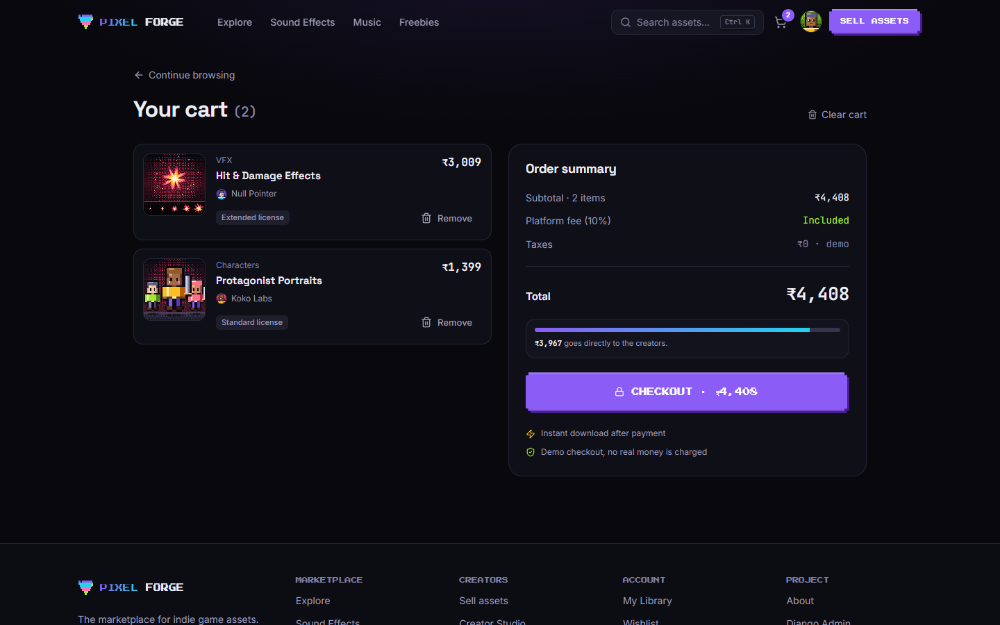
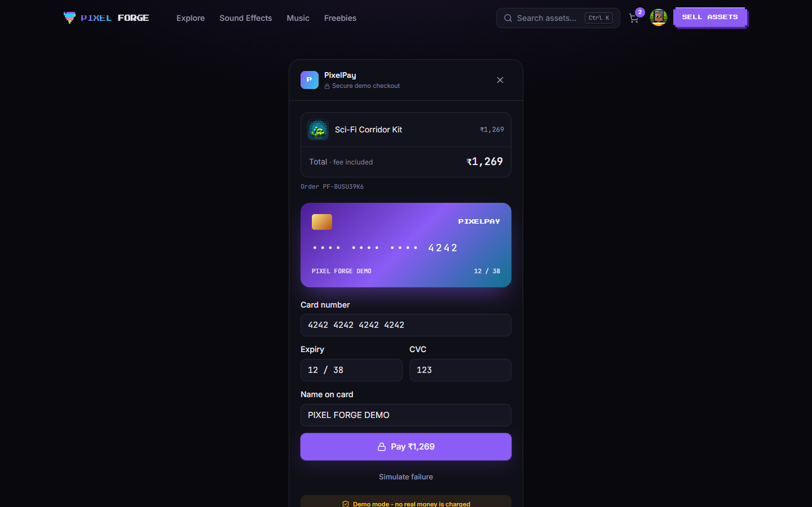
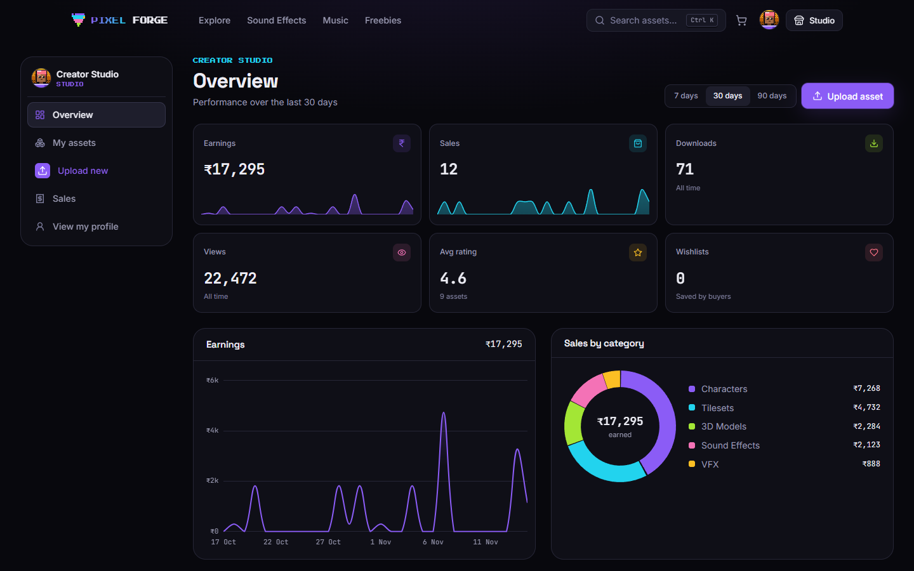
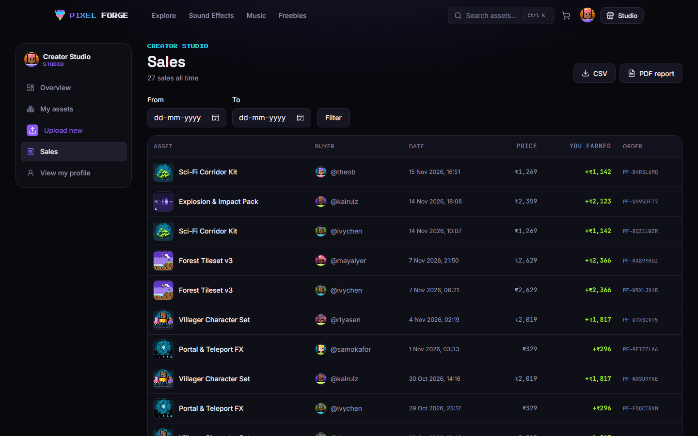
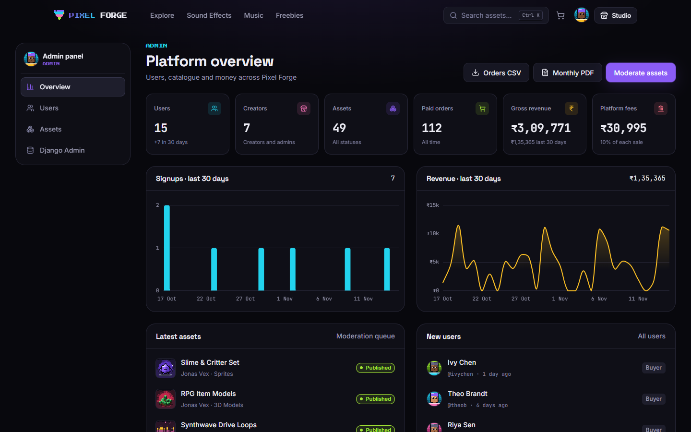
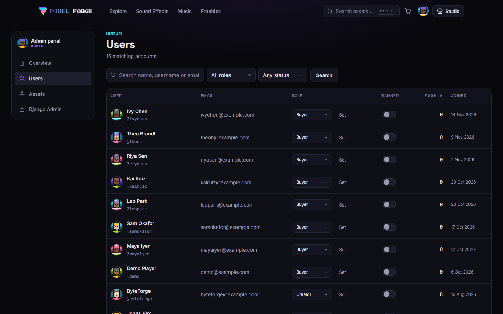
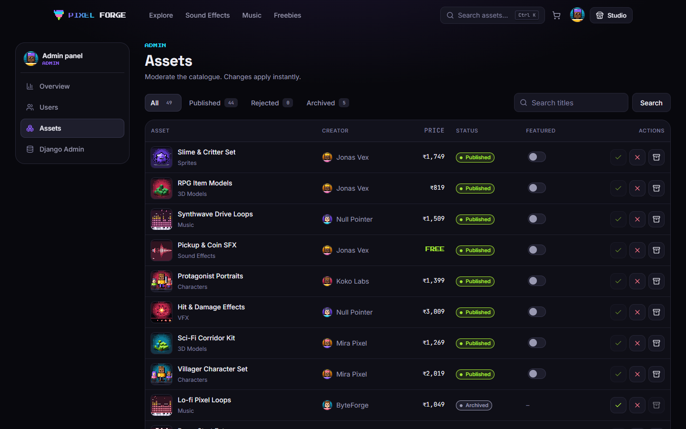
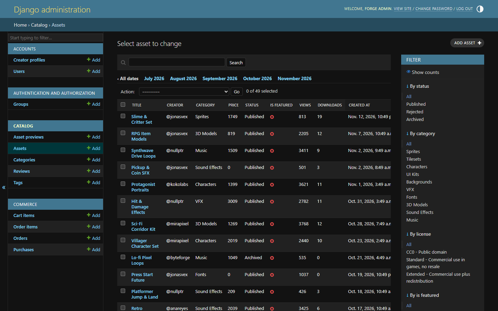

# Study Guide 3: Adwait — Cart, Orders, Payment, Downloads, Dashboards, Reports and Demo Data

> Read this top to bottom once. Then read the **Questions and Answers** part again before the viva.
> Every code snippet here is real and comes from the project. File paths are from the project root.

---

## 1. The project in 5 lines (everyone must know this)

- **Pixel Forge** is a website where game developers **buy and sell game assets** (sprites, sounds, music, 3D models).
- It is built with **Python 3 + Django 5.2** and a **SQLite** database. No React, no Node.
- There are **three kinds of users**: *buyer*, *creator* (seller) and *admin*.
- The project is split into five Django **apps**: `core`, `accounts`, `catalog`, `commerce`, `dashboard`.
- Payment is **simulated** (a fake card page). No real money moves.

| Person | Owns |
|---|---|
| Abhishek | Project setup, settings, URLs, login/register, users and roles |
| Parth | The catalogue: assets, search, filters, reviews, upload (creator studio) |
| **Adwait** | Cart, orders, payment, library, downloads, receipts, creator dashboard, admin panel, reports, demo data |
| Naman | Everything you see: templates, CSS, JavaScript, design, pixel art |

**You own the money and the numbers:** how something is bought, who can download it, and how sales are reported.

---

## 2. What you built (your part)

1. The **`commerce` app**: `CartItem`, `Order`, `OrderItem`, `Purchase` models.
2. **Business logic in `commerce/services.py`**: add to cart rules, create order, **idempotent** payment confirmation, claim free assets.
3. **Simulated payment page** ("PixelPay") with a *Simulate failure* button.
4. **Library** and **permission-checked downloads** from the private folder.
5. **PDF receipt** for each paid order (reportlab).
6. The **`dashboard` app**: creator studio overview and sales page, admin panel (overview, users, assets).
7. **Reports**: sales CSV + PDF, orders CSV, monthly summary PDF.
8. **Admin actions**: ban/unban (signs the user out everywhere), change role, approve / reject with reason / feature / archive assets.
9. The **demo data command** `python manage.py seed_demo`.
10. Tests: `commerce/tests.py` (22) and `dashboard/tests.py` (15).

### Your files

| File | What it does |
|---|---|
| `commerce/models.py` | The four models + fee helper functions |
| `commerce/services.py` | `add_to_cart`, `create_order`, `confirm_payment`, `claim_free` |
| `commerce/views.py` | cart, checkout, pay, pay_confirm, success, claim, library, download, receipt_pdf |
| `commerce/urls.py` | URLs |
| `commerce/admin.py` | Admin screens for orders/purchases |
| `dashboard/services.py` | ORM aggregation for dashboards |
| `dashboard/views.py` | Studio and admin pages, CSV and PDF exports |
| `dashboard/forms.py` | `DateRangeForm`, `UserFilterForm`, `RejectForm`, `RoleForm` |
| `core/pdf.py` | Shared reportlab helpers |
| `core/admin_utils.py` | "Export selected as CSV" admin action |
| `core/management/commands/seed_demo.py` | Fills the database with demo data |
| `commerce/tests.py`, `dashboard/tests.py` | 37 tests |

---

## 3. Architecture of your part

### The money flow

```
Cart  --checkout-->  Order (status: created)
                        |-- OrderItem (one per asset, price copied at that moment)
                        '-- pay page (PixelPay, fake)
                              |-- success --> Order = paid, Purchase rows created, cart cleared
                              '-- failure --> Order = failed (cart kept, can retry)
Library lists Purchases  -->  Download view checks ownership --> FileResponse from private_files/
```

### The four tables

```
CartItem   : user + asset            (unique together)  "I plan to buy this"
Order      : user, reference, subtotal, platform_fee, total, status, paid_at
OrderItem  : order, asset, title, price, creator, creator_earning   (a snapshot of the sale)
Purchase   : user + asset (unique together), order, price_paid, download_count   "I own this"
```

Why `OrderItem` copies `title`, `price` and `creator_earning`: if the creator later changes the price or deletes the asset, **old receipts and reports must not change**. That is called a *snapshot*.

### The fee rule

Buyers pay the listed price. The platform keeps **10%** (`PLATFORM_FEE_PERCENT` in settings) and the creator gets the rest.

```python
def fee_for(amount):      return int(round(amount * settings.PLATFORM_FEE_PERCENT / 100))
def earning_for(amount):  return amount - fee_for(amount)
```

Example: asset ₹1,000 → platform ₹100, creator ₹900. `fee + earning` always equals the price.

---

## 4. Concepts in simple language

**Transaction** — a group of database changes that either **all succeed or all fail**. Used so we never mark an order paid but forget to give the purchase.

**Atomic** — `@transaction.atomic` runs a function inside a transaction.

**Row locking (`select_for_update`)** — while one request is changing an order, a second request for the same order must wait. Stops double payment.

**Idempotent** — doing it twice has the same effect as doing it once. Our payment confirm is idempotent.

**`get_or_create`** — find a row, or create it if missing. Safe against duplicates.

**Order reference** — a readable id like `PF-82GXVQF2` shown to the customer instead of a database number.

**FileResponse** — streams a file from disk as a download without loading it all into memory.

**Aggregation** — `Sum`, `Count`, `Avg` calculated by the database.

**`TruncDate`** — turns a date-time into a date so we can group sales per day.

**Management command** — your own `python manage.py <name>` command. Ours is `seed_demo`.

**CSV vs PDF** — CSV is plain table data for Excel. PDF is a formatted document made with the **reportlab** library.

---

## 5. Code walk-through

### 5.1 Cart rules — `commerce/services.py`

`check_can_buy(user, asset)` is the single place for the rules. You cannot buy:
- an asset that is not published,
- your **own** asset,
- a **free** asset (free ones are *claimed*, not bought),
- something you **already own**.

`add_to_cart` uses these rules and `get_or_create`, so adding the same asset twice does not create two rows (there is also a database `UniqueConstraint`).

The cart view (`commerce/views.py::cart`) lists items, the subtotal and the creator share. The "+ cart" button works with AJAX (JSON reply with the new `cart_count`) and without JavaScript (redirect).



### 5.2 Checkout creates the order — `create_order`

```python
subtotal = sum(a.price for a in assets)
order = Order.objects.create(user=user, subtotal=subtotal, platform_fee=fee_for(subtotal), total=subtotal)
OrderItem.objects.bulk_create([
    OrderItem(order=order, asset=a, title=a.title, price=a.price, creator=a.creator,
              creator_earning=earning_for(a.price)) for a in assets])
order.platform_fee = sum(i.price - i.creator_earning for i in order.items.all())
```

- The `checkout` view accepts either **one asset** ("Buy now", POST field `asset`) or the **whole cart**.
- `total == subtotal` — the fee comes out of the creator's share, so the buyer pays no extra. `Order.clean()` enforces that.
- The order starts as `created`. Then the user is redirected to the pay page.
- `bulk_create` inserts all items in one query.

### 5.3 The most important function: `confirm_payment`

```python
@transaction.atomic
def confirm_payment(order, outcome):
    order = Order.objects.select_for_update().get(pk=order.pk)
    if order.status == Order.STATUS_PAID:
        return 'already_paid'
    if outcome != 'success':
        order.status = Order.STATUS_FAILED
        order.save(update_fields=['status'])
        return 'failed'
    order.status = Order.STATUS_PAID
    order.paid_at = timezone.now()
    order.save(update_fields=['status', 'paid_at'])
    for item in order.items.select_related('asset'):
        if item.asset_id:
            Purchase.objects.get_or_create(user=order.user, asset_id=item.asset_id,
                                           defaults={'order': order, 'price_paid': item.price})
    CartItem.objects.filter(user=order.user, asset_id__in=asset_ids).delete()
    return 'paid'
```

Explain step by step:
1. `@transaction.atomic` — all or nothing.
2. `select_for_update()` — locks the order row so two simultaneous clicks cannot both process it.
3. If already **paid** → return `already_paid`, change nothing (**idempotent**; a late "failure" can never undo a paid order).
4. If outcome is not success → mark **failed**. The cart stays so the user can retry. A failed order can still be paid later.
5. On success → mark paid + `paid_at`, create a `Purchase` for each item with `get_or_create` (no duplicate ownership), then remove those assets from the cart.

The view `pay_confirm` turns the result into a message: *paid*, *already paid (nothing charged twice)*, or *bank declined*.



**The fake card page** shows a demo card (4242 4242 4242 4242), a clear "Demo mode, no real money is charged" notice, a **Pay** button and **Simulate failure**. There is no payment gateway, no API keys and no real card data.

### 5.4 Who may see an order — `_own_order`

```python
order = get_object_or_404(Order..., reference=reference)
if order.user_id != request.user.id and not request.user.is_admin_role:
    raise PermissionDenied
```

Another user cannot open your pay page, receipt or success page by guessing the reference. They get 403.

### 5.5 Claiming free assets — `claim_free`

Free assets skip the cart. `claim` creates a `Purchase` with `order=None` and `price_paid=0`. Same checks: published, not your own, really free. `get_or_create` makes double-clicking harmless.

### 5.6 Library and secure downloads

```python
@login_required
def download(request, slug):
    asset = get_object_or_404(Asset, slug=slug)
    purchase = Purchase.objects.filter(user=user, asset=asset).first()
    if not (purchase or asset.creator_id == user.id or user.is_admin_role):
        raise PermissionDenied
    root = Path(asset.file.storage.location).resolve()
    path = (root / asset.file.name).resolve()
    if root not in path.parents or not path.is_file():
        raise Http404('File not found')
    if purchase:
        Purchase.objects.filter(pk=purchase.pk).update(download_count=F('download_count') + 1, ...)
        Asset.objects.filter(pk=asset.pk).update(downloads=F('downloads') + 1)
    return FileResponse(open(path, 'rb'), as_attachment=True, filename=...)
```

Key points to say:
- Only the **buyer**, the **creator** or an **admin** can download. Others get **403**.
- The folder `private_files/` is **not served by any URL** (checked in a test), so there is no direct link to steal.
- **Path traversal guard**: the resolved path must be *inside* the private root. A value like `../../secret` is refused.
- Only real buyers increase the download counters (creator and admin downloads do not).
- `as_attachment=True` makes the browser save the file.


### 5.7 PDF receipt — `receipt_pdf`

Uses **reportlab** through the helpers in `core/pdf.py` (`build_pdf`, `table`, `rupees`). The receipt has the items, subtotal, platform fee note, total and a "demo transaction" footer. It is only available for **paid** orders and only for the owner (otherwise 404 / 403). Response header: `Content-Type: application/pdf`.

Note: reportlab's standard fonts cannot print the ₹ sign, so the PDF writes `Rs 1,269`.

### 5.8 Creator dashboard — `dashboard/services.py::creator_stats`

Numbers come from the database, not Python loops:

```python
items  = OrderItem.objects.filter(creator=user, order__status='paid', order__paid_at__gte=start)
totals = items.aggregate(revenue=Sum('creator_earning'), sales=Count('id'))
per_day = items.annotate(day=TruncDate('order__paid_at')).values('day').annotate(revenue=Sum('creator_earning'), sales=Count('id'))
by_cat  = items.values('asset__category__name').annotate(revenue=Sum('creator_earning'))...
top     = items.values('asset_id').annotate(revenue=..., sales=...).order_by('-revenue')[:5]
```

- Works for **7 / 30 / 90 days**.
- Days with no sales are filled with 0 so the chart line is continuous.
- Returns KPIs (earnings, sales, downloads, views, average rating, wishlists), a daily series, sales by category and the top 5 assets.
- `studio_overview` passes the data to the template as JSON (`json_script`) and Naman's `dashboard.js` draws the charts with Chart.js. A brand-new creator with zero data still sees an empty-state without errors.





### 5.9 Reports

| Report | View | Notes |
|---|---|---|
| Sales CSV | `sales_csv` | A creator sees **only their own** sales. Optional date range (`DateRangeForm`) |
| Sales PDF | `sales_pdf` | Table + summary: gross, platform fee, your earnings |
| Orders CSV (admin) | `orders_csv` | All paid orders |
| Monthly summary PDF (admin) | `summary_pdf` | Revenue, fees, new users, top creators, top assets. `?month=2026-05` or current month (`month_bounds`) |

### 5.10 Admin panel

All views use `@admin_required`.

- **Overview** (`admin_overview` + `admin_stats`): users, creators, assets, paid orders, gross revenue, platform fees, signups per day, revenue per day.
- **Users** (`admin_users`): search, filter by role and banned status. `admin_ban` sets `is_active = False` and calls `sign_out_everywhere(user)`, which deletes that user's sessions from the `django_session` table so they are logged out immediately. An admin **cannot ban or change the role of themselves**. `admin_role` changes the role using `RoleForm`.
- **Assets** (`admin_assets` + `admin_moderate`): actions `publish`, `reject` (a reason is **required**, 5–300 characters, validated by `RejectForm`), `archive`, `feature` / `unfeature` (only published assets can be featured). The creator sees the rejection reason in their studio.







There is also Django's built-in `/admin/` for raw data (with an "Export selected as CSV" action from `core/admin_utils.py`).



### 5.11 Demo data — `seed_demo`

`python manage.py seed_demo` creates, in one transaction:
- 15 users: admin, 6 creators, 8 buyers (including `demo`). Password for all: `Password123`.
- 49 assets across all categories, with **generated** thumbnails, sprite sheets, audio (made with Python's `wave` module) and zip/obj files. No downloaded files are needed.
- 112 paid orders spread over the last 60 days, purchases and 115 reviews.

`--reset` clears old data and generated files first. A fixed random seed keeps the result predictable.

---

## 6. How to demo your part (90 seconds)

1. Log in as `demo` (buyer). Add two assets to the **cart** → open the cart.
2. **Checkout** → on the PixelPay page click **Simulate failure** → see the error and that the cart is untouched.
3. Click **Pay** → success page with confetti, then **Download receipt (PDF)**.
4. Open **Library** → download a file. Show that `/private_files/...` gives 404.
5. Log in as `mirapixel` (creator) → **Studio**: change 7/30/90 days, open **Sales**, download **CSV** and **PDF**.
6. Log in as `admin` → **Panel**: ban a user, reject an asset with a reason, feature an asset, download **Monthly PDF**.
7. Run `python manage.py test commerce dashboard`.

---

## 7. Questions and Answers

### Models and design

**Q1. Explain your four models.**
`CartItem` = a wish to buy. `Order` = one checkout with totals and status. `OrderItem` = one asset inside an order with the price and creator earning copied at that time. `Purchase` = ownership: one row per user per asset.

**Q2. Why do you copy `title` and `price` into `OrderItem`?**
Receipts and reports must stay correct even if the creator changes the price or deletes the asset later. `asset` uses `SET_NULL` so history survives.

**Q3. Why is there both `OrderItem` and `Purchase`?**
`OrderItem` is the *financial record* (what was charged and who earned). `Purchase` is the *access record* (who can download). Free claims have a `Purchase` but no order.

**Q4. What constraints did you add?**
`UniqueConstraint(user, asset)` on `CartItem` and on `Purchase`; `reference` is unique on `Order`.

**Q5. How is the order reference generated?**
`make_reference()` uses the `secrets` module to make `PF-` + 8 random uppercase letters/digits. It is not guessable and not a database id.

**Q6. How is the platform fee calculated?**
`fee_for(amount) = round(amount × 10 / 100)`. The creator gets `amount − fee`. The 10 comes from `settings.PLATFORM_FEE_PERCENT`.

**Q7. Who pays the fee?**
It comes out of the creator's share. The buyer's total equals the listed prices.

### Payment

**Q8. How does your payment work?**
It is a simulation. The pay page posts `outcome=success` or `outcome=fail` to `pay_confirm`, which calls `confirm_payment`. No gateway or real card is involved.

**Q9. What does idempotent mean? Show it in your code.**
Running the same operation again has no extra effect. In `confirm_payment`, if the status is already `paid` we return immediately. Tests post success twice and then fail and check that status, `paid_at` and purchases do not change.

**Q10. Why `transaction.atomic`?**
Marking the order paid, creating purchases and clearing the cart must all happen together. If one step crashes, everything rolls back.

**Q11. Why `select_for_update`?**
It locks the order row, so two parallel requests are processed one after the other. The second sees `paid` and stops. (SQLite ignores row locks but its writes are serialised; on PostgreSQL the lock is real.)

**Q12. What happens if payment fails?**
Order status becomes `failed`, the cart is untouched, no purchases are created. The user can press Pay again on the same order.

**Q13. Why `get_or_create` for purchases?**
If the code runs twice we never create two ownership rows for the same user and asset.

**Q14. How do you prevent a user buying their own or an owned asset?**
`check_can_buy` in `services.py`, enforced both when adding to cart and when creating the order.

**Q15. What if an asset is archived while it is in someone's cart?**
`buyable_assets` filters it out at checkout, and the cart page shows only published items.

### Downloads and security

**Q16. How do you protect paid files?**
Stored in `private_files/`, outside any served folder. The storage class has no URL. Only the `download` view serves it, after checking purchase / creator / admin.

**Q17. What is path traversal and how did you stop it?**
Using `../` in a file name to escape the folder. We resolve the absolute path and require that the private root is one of its parents.

**Q18. Who can download?**
The buyer, the creator of the asset, and admins. Anonymous users are sent to login; others get 403.

**Q19. Why `FileResponse`?**
It streams the file in chunks and sets headers, so big files do not fill memory.

**Q20. Why `F('download_count') + 1`?**
The database does the addition itself, so two simultaneous downloads do not overwrite each other's count.

**Q21. Who is allowed to view a receipt?**
Only the order owner (and admin), and only if the order is paid.

### Dashboards and reports

**Q22. How do you build the daily sales chart?**
`TruncDate('order__paid_at')` groups paid items per day, `Sum` and `Count` give revenue and sales. Missing days are filled with zero in Python so the line has no gaps.

**Q23. Difference between `aggregate` and `annotate`?**
`aggregate` → one result for the whole queryset (total revenue). `annotate` → one value per row or per group (revenue per day, per category).

**Q24. What does `values()` do before `annotate()`?**
It sets the **GROUP BY**. `values('day').annotate(Sum(...))` means "sum per day".

**Q25. How do charts get their data?**
The view puts the numbers into the template with `json_script`; Chart.js (loaded from a CDN) reads that JSON. No separate API is needed.

**Q26. How do you produce a CSV?**
An `HttpResponse` with `content_type='text/csv'` and `Content-Disposition: attachment`; `csv.writer` writes rows into the response. A UTF-8 BOM makes Excel read ₹ and accents correctly.

**Q27. How do you produce a PDF?**
With **reportlab**: build a list of flowables (paragraphs, tables), `SimpleDocTemplate.build()` writes to an in-memory buffer, and we return the bytes as `application/pdf`.

**Q28. Can a creator download another creator's sales?**
No. `sales_queryset(request.user)` filters by `creator=request.user`.

**Q29. What if there are no sales yet?**
Totals use `or 0`, the chart gets zeros, the table shows an empty-state row. A test checks CSV and PDF still return correctly with no data.

### Admin panel

**Q30. How does ban work?**
Set `is_active=False` (login is blocked) and delete the user's sessions so they are logged out everywhere immediately.

**Q31. Can an admin ban themselves?**
No: the view refuses (and the same for changing own role) so the site is never left without an admin.

**Q32. How does reject work?**
A reason is required (validated by `RejectForm`). Status becomes `rejected`, `is_featured` is cleared, the reason is stored on the asset and shown to the creator.

**Q33. Why are the admin views protected twice (decorator and checks)?**
`@admin_required` stops non-admins at the door (403). Extra checks inside protect against admin mistakes (self-ban).

**Q34. What is the difference between your admin panel and Django Admin?**
The panel is a custom, designed interface for daily tasks (moderation, user management, reports). Django Admin is the automatic CRUD tool for raw data. We use both.

### Seed data

**Q35. What does `seed_demo` do and why?**
It builds a realistic demo database in seconds: users, assets, orders over time, reviews. Everything is generated by code (pixel art, synthesized audio), so the repository has no binary files and every teammate sees the same data.

**Q36. How is it made repeatable?**
A fixed random seed, one transaction (all or nothing), and `--reset` that clears data and generated files.

### Testing

**Q37. What do your tests prove?**
Fee maths adds up; cart rules (anonymous, own asset, owned/unpublished, remove); checkout totals and fee split; successful payment grants purchases and clears the cart; payment is idempotent; failure keeps the cart and can be retried; other users get 403; empty-cart checkout; buy-now; free claim once only; downloads (anonymous redirected, stranger 403, buyer OK and counters change, creator/admin OK without counting, private file has no URL); receipt only when paid and only for the owner; dashboards (anonymous, buyer, creator, admin access), zero-data pages, creator sees only own sales, ban/unban, cannot ban self, reject needs reason, feature rules, role change.

**Q38. Why do tests use a temporary folder?**
A shared `TempStorageTestCase` points `MEDIA_ROOT` and `PRIVATE_FILES_ROOT` to a temp directory, so tests never write into the real folders.

---

## 8. Tricky questions the teacher may ask

- **"What if two tabs click Pay at the same time?"** → The second waits for the lock, sees status `paid` and returns `already_paid`. Only one set of purchases exists.
- **"Why store totals instead of calculating them?"** → Prices can change later. Stored totals keep history correct.
- **"Is it safe that anyone with the URL can't download?"** → Yes, the view checks ownership on every request; there is no public URL to the file.
- **"Why `Rs` and not ₹ in PDFs?"** → The built-in PDF fonts do not contain the ₹ glyph. Using a custom TTF font would fix it.
- **"Is this real payment?"** → No. It is a lab simulation; real payment would use a gateway such as Razorpay or Stripe with server-side verification and webhooks.
- **"What if the creator changes the price after I paid?"** → My `OrderItem` keeps the price I paid.

---

## 9. One-page cheat sheet

- Models: CartItem, Order, OrderItem, Purchase. Fee 10% from the creator share.
- Order status: `created` → `paid` or `failed` (retry allowed).
- `confirm_payment`: atomic + `select_for_update` + idempotent + `get_or_create`.
- Downloads: private folder, permission check, path-traversal guard, `FileResponse`, `F()` counters.
- Dashboard: `Sum/Count/Avg/TruncDate`, 7/30/90 days, charts via `json_script` + Chart.js.
- Reports: CSV (`csv` module), PDF (`reportlab`).
- Admin: ban + sign-out-everywhere, role change, approve/reject/feature/archive.
- Seed: `python manage.py seed_demo [--reset]`.
- Test: `python manage.py test commerce dashboard`.
