# Study Guide 4: Naman — Frontend: Templates, Design System, JavaScript and Pixel Art

> Read this top to bottom once. Then read the **Questions and Answers** part again before the viva.
> Every code snippet here is real and comes from the project. File paths are from the project root.

---

## 1. The project in 5 lines (everyone must know this)

- **Pixel Forge** is a website where game developers **buy and sell game assets** (sprites, sounds, music, 3D models).
- It is built with **Python 3 + Django 5.2** and a **SQLite** database. No React, no Node.
- There are **three kinds of users**: *buyer*, *creator* (seller) and *admin*.
- The project is split into five Django **apps**: `core`, `accounts`, `catalog`, `commerce`, `dashboard`.
- Payment is **simulated** (a fake card page). No real money moves.

| Person | Owns |
|---|---|
| Abhishek | Project setup, settings, URLs, login/register, users and roles |
| Parth | The catalogue: assets, search, filters, reviews, upload (creator studio) |
| Adwait | Cart, orders, payment, downloads, dashboards, reports, demo data |
| **Naman** | **Everything the user sees and touches:** templates, CSS design system, JavaScript, pixel art, error pages |

**You own the look and feel of the whole product.**

---

## 2. What you built (your part)

1. **Template system** (Django Template Language): one `base.html`, reusable **partials**, and a page template for every screen.
2. **Design system** in one CSS file: colours, fonts, buttons, forms, cards, modals, tables, dashboards, animations, responsive layouts.
3. **JavaScript** (vanilla, no frameworks): toasts, modals, AJAX forms, command palette, audio player, image viewer, upload wizard, charts, home animations.
4. **Custom template tags and filters** (`core/templatetags/pf.py`).
5. **Generated pixel art and sound**: `core/pixelart.py` (Pillow) and `core/synth.py` (standard library) draw thumbnails, avatars, banners, illustrations and make audio — no image files needed.
6. **Error pages**: 403, 404 (with a mini-game), 500.
7. **Accessibility, responsiveness, SEO tags, offline banner, reduced-motion support.**

### Your files

| Area | Files |
|---|---|
| Base layout | `templates/base.html` |
| Partials | `templates/partials/` → `navbar`, `footer`, `logo`, `asset_card`, `price_tag`, `rating_stars`, `pagination`, `empty_state`, `field`, `player`, `palette`, `messages_inline` |
| Error pages | `templates/403.html`, `404.html`, `500.html` |
| Page templates | `core/templates/core/home.html`, `accounts/templates/accounts/*`, `catalog/templates/catalog/*`, `commerce/templates/commerce/*`, `dashboard/templates/dashboard/*` |
| CSS | `static/css/pixelforge.css` |
| JavaScript | `static/js/app.js`, `player.js`, `explore.js`, `detail.js`, `studio.js`, `dashboard.js`, `home.js`, `minigame.js` |
| Template tags | `core/templatetags/pf.py` |
| Generated art / sound | `core/pixelart.py`, `core/synth.py` |
| Images | `static/img/` (logo, favicon, apple-touch icon, OG image) |

---

## 3. Architecture of your part

### 3.1 Template inheritance

```
base.html  (head, navbar, <main>, footer, player, palette, toasts, scripts)
   |--     
   |--       <-- every page fills this
   '--      <-- page-specific scripts
        ├── home.html, explore.html, detail.html, cart.html ...
        └── dashboard/_base.html  (sidebar) --> studio.html, admin.html ...
```

- **``** — the page reuses the layout.
- **``** — the page fills the empty slot.
- **``** — drop a reusable piece anywhere.

The asset card is written **once** and used on Home, Explore, Library, Wishlist, Profile and the detail page's "related" row.

### 3.2 Progressive enhancement (say this sentence in the viva)

> "Every feature works without JavaScript. JavaScript only makes it faster and nicer."

- Filters are a normal GET form → JavaScript turns it into AJAX.
- Heart / cart buttons are POST forms → JavaScript sends them with `fetch` and shows a toast.
- The upload wizard is five stacked sections → JavaScript turns it into steps with a progress bar.
- Django `messages` are printed in the HTML → JavaScript turns them into toasts.

### 3.3 Libraries (all from a CDN, no npm)

| Library | Used for |
|---|---|
| **WaveSurfer.js 7** | Audio waveform on the detail page |
| **Chart.js 4** | Dashboard charts |
| **Lucide** | Icons |
| **Google Fonts** | Space Grotesk, Inter, JetBrains Mono, Press Start 2P |

---

## 4. Concepts in simple language

**Django Template Language (DTL)** — HTML with `{{ variable }}`, `` and `{{ value|filter }}`. Auto-escapes HTML to stop XSS.

**Template tag / filter** — small Python functions you can call in templates. `{{ asset.price|inr }}` → `₹1,749`.

**Static files** — CSS, JS, images that do not change. `` and ``.

**CSS custom properties (variables)** — `--primary: #8b5cf6;` defined once, used everywhere as `var(--primary)`. Change one line to retheme.

**AJAX / fetch()** — JavaScript asks the server for data in the background without reloading the page.

**JSON** — a text format for data that Python and JavaScript both understand.

**Debounce** — wait until the user stops typing for a moment before searching, so we do not send a request on every key.

**Event delegation** — one listener on `document` handles clicks for many elements (`e.target.closest('[data-...]')`).

**`data-*` attributes** — HTML attributes our JS reads, e.g. `data-ajax="wishlist"`, `data-play`, `data-confirm`.

**ARIA** — attributes like `role="dialog"` and `aria-label` that help screen readers.

**Responsive design** — layouts that adapt to phone, tablet, desktop using media queries.

**`prefers-reduced-motion`** — a user setting. If on, we turn animations off.

**Canvas** — an HTML element JavaScript can draw pixels on. Used for the home background and the 404 game.

---

## 5. Code walk-through

### 5.1 Design system — `static/css/pixelforge.css`

Named **"Neo-retro arcade"**: near-black background, purple and cyan accents, pixel fonts for headings.

Tokens (colours, fonts, radii) live in `:root`:

```css
:root {
  --bg: #08080d;      --surface: #0f0f17;   --text: #ededf5;
  --primary: #8b5cf6; --accent: #22d3ee;    --danger: #fb7185;
  --font-pixel: 'Press Start 2P', monospace;
}
```

The file is organised in 12 labelled sections: tokens, base, layout, buttons, forms, display, overlays, navbar/footer, asset cards, pages, dashboards, motion.

**The pixel button** (`.pixel-btn`) has stepped corners made with `clip-path: polygon(...)` and a darker offset shadow, so it looks like an 8-bit button.

**Responsive:** media queries at 768 px, 1280 px and 1600 px. For example the dashboard KPI cards are 2 columns on phones, 3 on tablets/laptops and 6 only on very wide screens.

**Accessibility choices:**
- A "Skip to content" link at the top (`.skip-link`).
- Visible focus rings; text colour `--subtle` was raised to `#8080a0` for contrast on the dark background.
- `@media (prefers-reduced-motion: reduce)` disables animations and transitions.

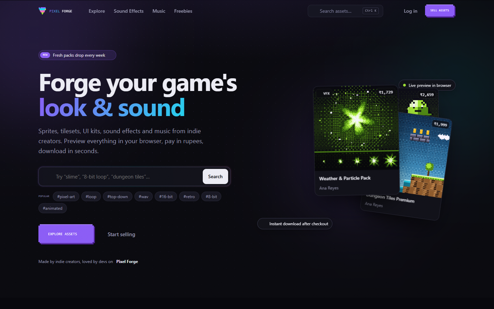

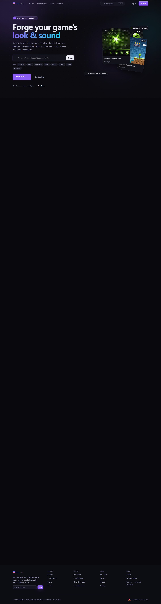

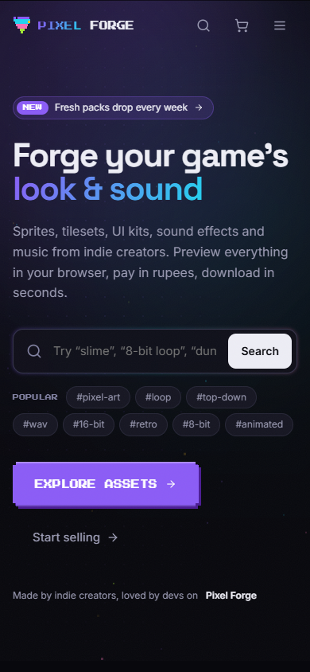

### 5.2 `base.html`

Key parts to explain:
- `<title>` and `<meta name="description">` come from blocks, so each page sets its own **SEO** text.
- Open Graph tags (`og:title`, `og:image`...) give nice link previews; the detail page overrides them with the asset's own thumbnail.
- `<meta name="theme-color" content="#08080D">`, favicon (SVG + PNG) and `apple-touch-icon`.
- ``, footer, global audio player, command palette.
- An **offline banner** (`#offline-banner`) shown by JavaScript when the browser loses internet.
- A `<ul id="django-messages">` that prints Django messages; JS reads them and shows toasts.
- Scripts at the bottom: Lucide (CDN), `app.js`, `player.js`, then ``.

### 5.3 Custom template tags — `core/templatetags/pf.py`

Loaded with ``. Examples:

| Filter / tag | Does |
|---|---|
| `inr` | `1749` → `₹1,749` (Indian digit grouping) |
| `filesize` | bytes → `3.2 MB` |
| `duration` | seconds → `0:42` |
| `wave_bars` | makes a fake waveform (bar heights) from a seed for audio cards |
| `in_set` | "is this id in the wishlist/owned set?" |
| `star` / `star_svg` | draws filled or empty star icons |
| `qs` (simple tag) | rebuilds a URL query string while changing one parameter (used by pagination and filters) |

They are registered with `@register.filter` and `@register.simple_tag(takes_context=True)`.

### 5.4 Asset card partial — `partials/asset_card.html`

One reusable card: thumbnail, category chip, price tag, title, creator, rating stars, sales, heart button, "owned" badge, and a **play button for audio assets** (`data-play` attributes). It reads `wishlist_ids` and `owned_ids` from Abhishek's context processor to show the right state.

### 5.5 `app.js` — the main script (about 480 lines)

It is one wrapped function (IIFE) exposing a small `pf` helper object. Main features:

| Feature | How it works |
|---|---|
| **CSRF + fetch helper** | `pf.fetch(url, opts)` reads the `csrftoken` cookie and adds `X-CSRFToken` and `X-Requested-With` headers |
| **Toasts** | `pf.toast(message, level)` creates a popup. At page load, Django messages are converted into toasts |
| **Modals** | `pf.openModal` / `pf.closeModal` with **focus trap** (Tab stays inside), Esc to close, focus returns to the trigger |
| **Confirm dialog** | Any `<form data-confirm="...">` shows a styled confirm box before submitting (used for archive, delete) |
| **AJAX forms** | `form[data-ajax=wishlist|cart|remove]` post with `fetch`, update the heart or cart badge, show a toast |
| **Heart burst** | A little pixel-particle explosion when you wishlist |
| **Cart badge bounce** | `setCartCount(n)` updates and animates the number |
| **Command palette** | `Ctrl/Cmd + K` opens it; typing (debounced) calls `/api/search/`; arrow keys + Enter navigate; recent searches saved in `localStorage` |
| **Count-up numbers** | `data-countup` numbers animate once when they scroll into view |
| **Reveal on scroll** | `IntersectionObserver` fades sections in |
| **Confetti** | After a successful payment |
| **Offline banner** | listens to `online` / `offline` events |
| **Prefetch** | On hover/touch, adds `<link rel="prefetch">` for same-site pages so navigation feels instant (skipped on data-saver or 2G) |

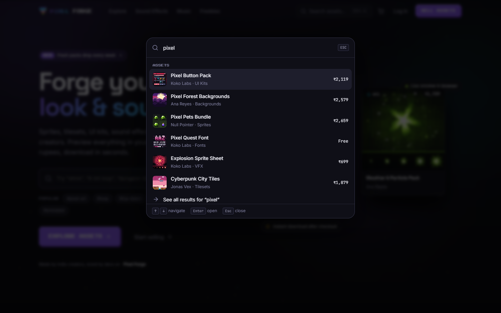

**How the AJAX wishlist works end to end:**

1. The template has `<form method="post" data-ajax="wishlist" action="/wishlist/toggle/<slug>/">` with ``.
2. JS intercepts `submit`, calls `pf.fetch(form.action, {method:'POST'})`.
3. Abhishek's view sees `X-Requested-With: XMLHttpRequest` and returns JSON `{in_wishlist: true, message: ...}`.
4. JS toggles the heart class, plays the burst, shows a toast.
5. If JS is off, the form posts normally and the server redirects.

### 5.6 `explore.js` — live filtering

- Collects all form fields into `URLSearchParams`.
- `load(params)` does `pf.fetch(url)` and replaces `#results` with the returned HTML partial (from Parth's view).
- A counter `seq` ensures **only the newest request wins** if responses arrive out of order.
- `history.pushState` updates the address bar; the back button re-loads the right results.
- On error it falls back to a normal page load.
- On phones the filters appear in a slide-up sheet.

### 5.7 `player.js` + WaveSurfer in `detail.js`

- **One `<audio>` element for the whole site**, so only one sound can play at a time. Any element with `[data-play]` and `data-url`, `data-title`... starts a track in the bottom player.
- When the detail page's WaveSurfer waveform starts, it dispatches `pf:wave-start`, and the global player pauses (and the other way round) via custom events.
- WaveSurfer is **destroyed** when leaving the page, to free memory.
- `detail.js` also has the **image viewer**: zoom, pan, dark / light / checkerboard background (to see transparency), and a **sprite-sheet animator** that plays frames using CSS `steps()` with an FPS slider. Tabs for Description / Reviews / More from the creator / Related.

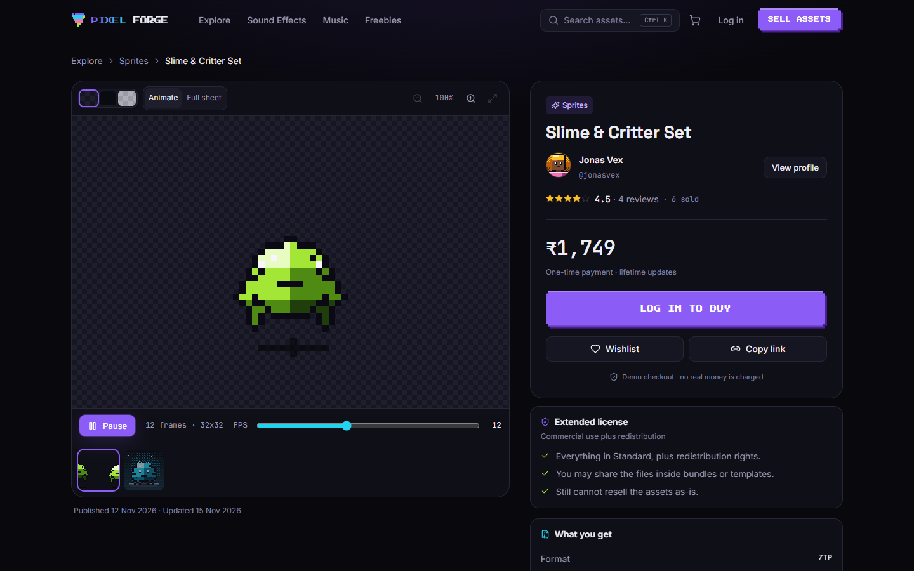

### 5.8 `studio.js` — the upload wizard

- Without JS: five sections stacked, normal form post.
- With JS: stepper (Basics, Media, Details, Pricing, Review) with slide transitions.
- **Live preview card** updates as you type.
- Inline validation that **mirrors the server rules** (extension, 25 MB, tag limits).
- Detects **audio duration** from the chosen file.
- **Draft autosave** in `localStorage` (key `pf_upload_draft_v2`) so a refresh does not lose work.
- Submit uses **XMLHttpRequest** (not fetch) because it provides **upload progress events** → a pixel-style progress bar. On errors it maps the server's JSON `errors` onto the fields.

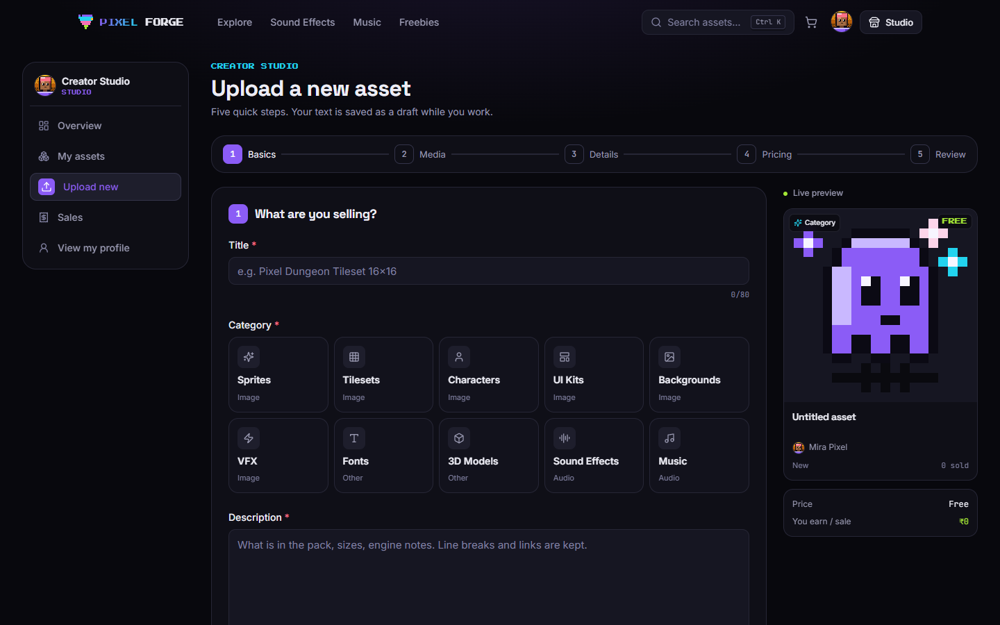

### 5.9 `dashboard.js` — charts

- Reads data from `json_script` blocks (`document.getElementById('chart-data')`).
- Draws sparklines, area chart, bar chart and doughnut with **Chart.js 4**.
- Safe with **all-zero data** (a brand-new creator) — no errors, just an empty chart.
- Respects reduced motion (`Chart.defaults.animation = false`).

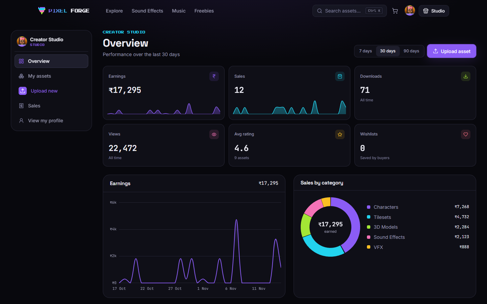

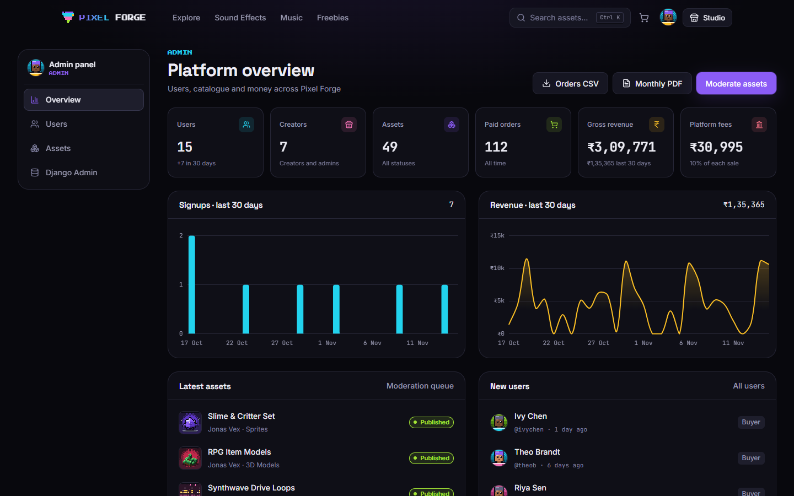

### 5.10 `home.js` and the hero

- A `<canvas>` of tiny drifting pixels that **brighten near the mouse**; it pauses when off-screen (IntersectionObserver) or when reduced-motion is set.
- A gentle **3D tilt** on the floating card stack following the mouse.

### 5.11 Generated art — `core/pixelart.py`

A small **drawing engine with Pillow** (`Canvas` class draws pixels, outlines, shading). Functions such as `creature()`, `humanoid()`, `scene_tileset()`, `scene_3d()` draw different content. A seeded random generator means **the same seed always gives the same picture**.

URLs that return PNGs: `/avatar/<username>.png`, `/art/<category>.png`, `/illustration/<kind>.png`, `/banner/<seed>.png`, `/sheet/<seed>.png`. They have `Cache-Control: max-age=86400` so the browser keeps them for a day. **Why:** the repository needs no image files, and every user and asset gets a unique picture.

`core/synth.py` uses only Python's `wave`, `struct`, `math` to create 16-bit WAV sound effects and a chiptune loop, and `.obj` 3D models, for the demo data.

### 5.12 Error pages and the 404 mini-game

`templates/404.html` shows a big pixel "404", "This level doesn't exist", and a **canvas game**: a purple block runs, you jump over pink blocks with **Space / ↑ / tap**; score and best score (saved in `localStorage`). Buttons: Back to home, Explore. Code in `static/js/minigame.js` (a game loop with `requestAnimationFrame`, simple gravity and rectangle collision).

*(Django shows its own yellow 404 page while `DEBUG = True`; our page appears when `DEBUG = False`.)*

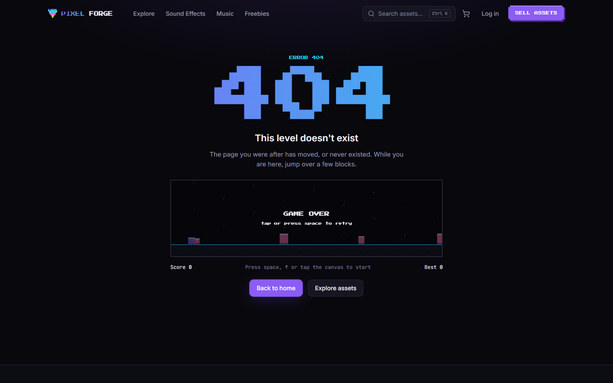

### 5.13 Other pages you built (for your demo)

| Page | Screenshot |
|---|---|
| Login | 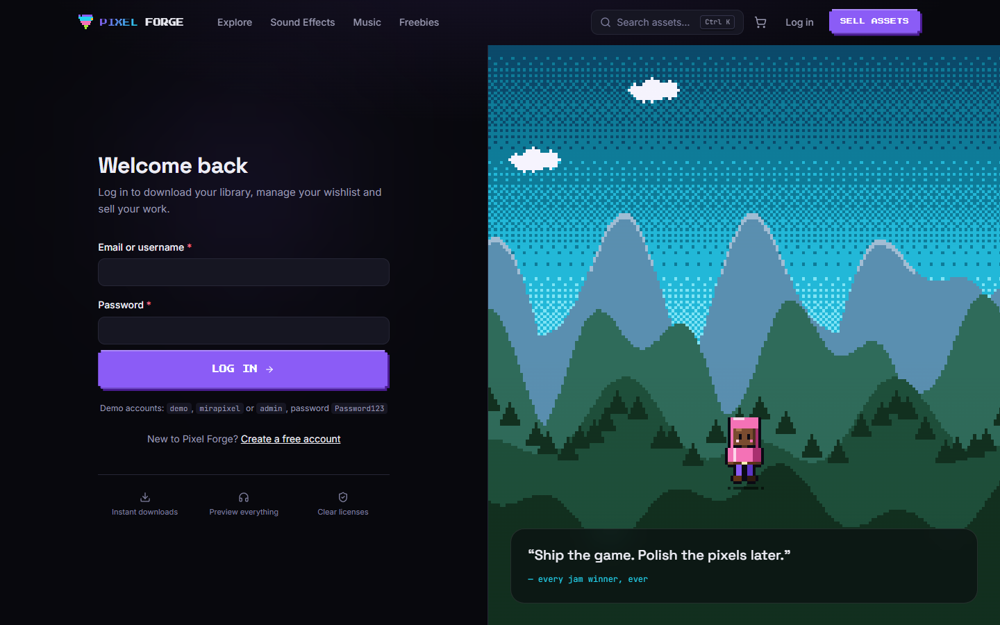 |
| Register | 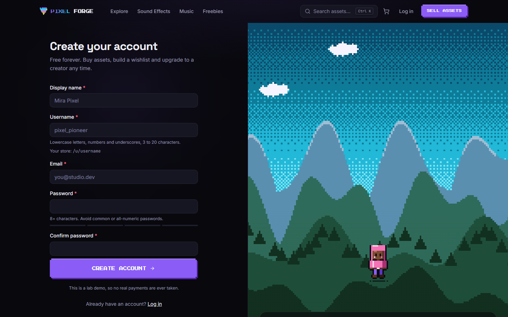 |
| Library | 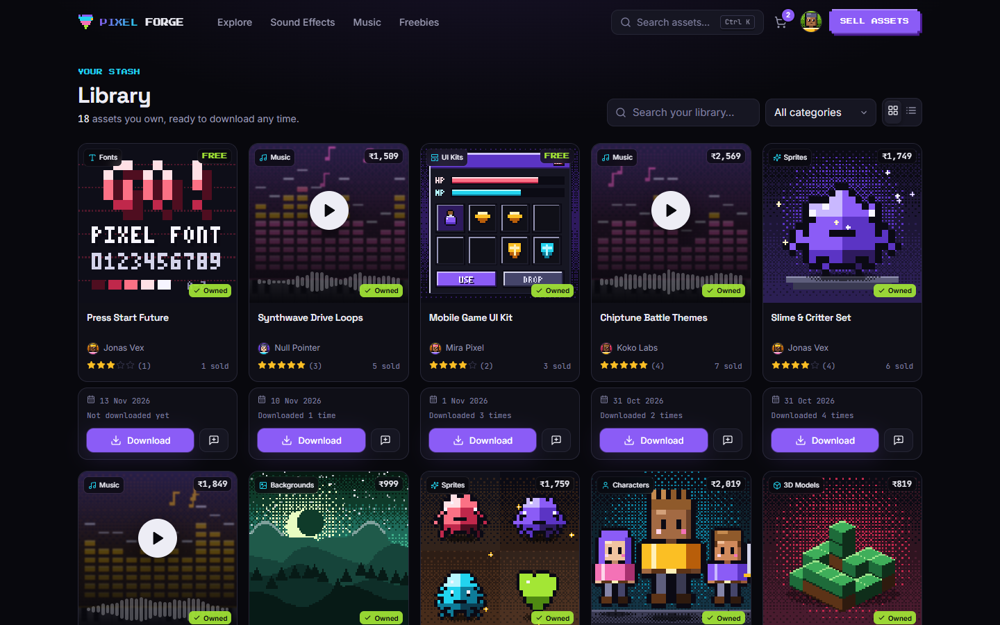 |
| Cart | 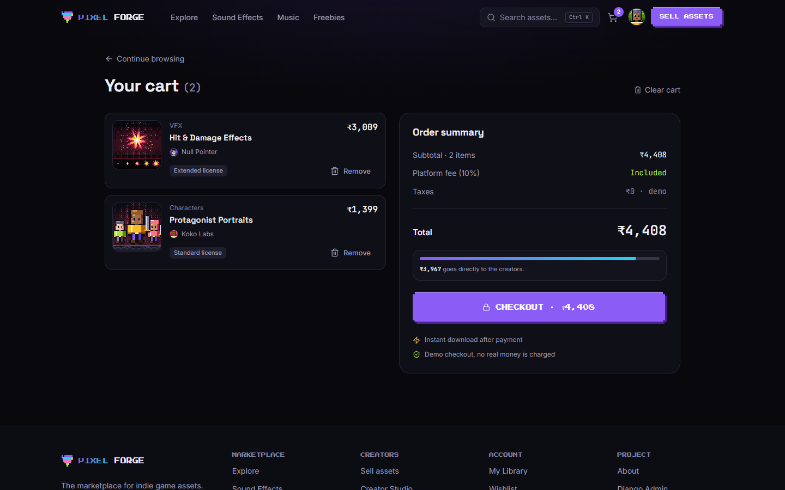 |
| Payment | 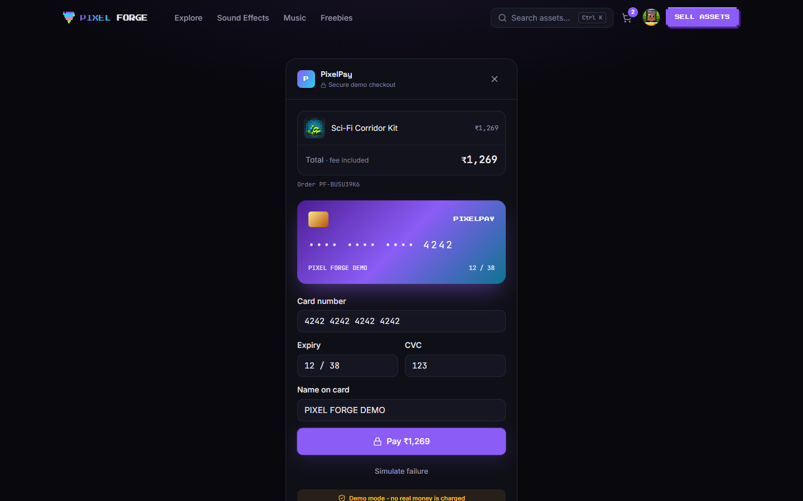 |
| Studio assets | 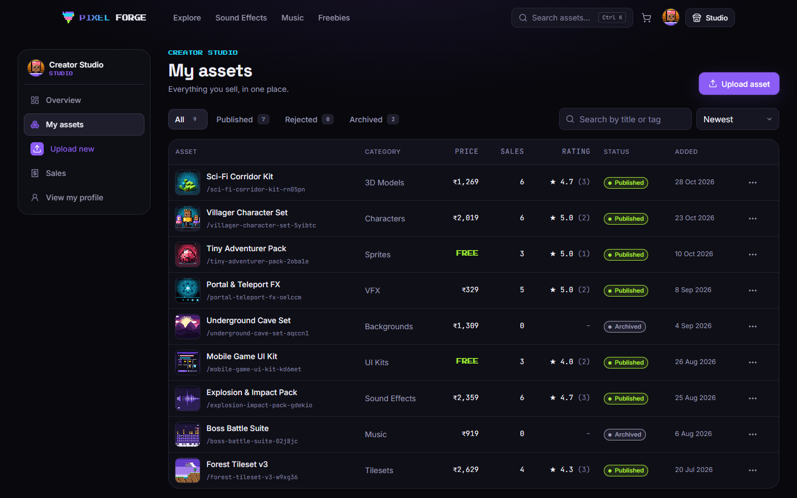 |
| Admin users | 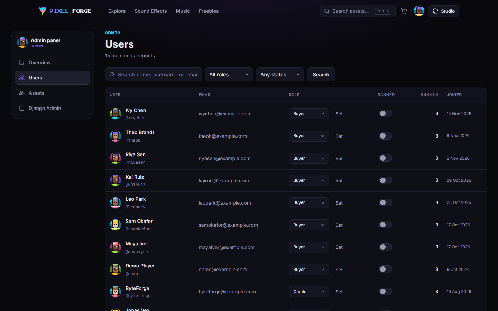 |

---

## 6. How to demo your part (90 seconds)

1. **Home**: move the mouse over the hero (pixels light up, cards tilt). Scroll: numbers count up, rails slide in.
2. Press **Ctrl + K**, type "pixel", use arrow keys, Enter.
3. **Explore**: filter, watch the grid change without reload. Resize the window to phone width — layout changes.
4. Click the **heart** on an asset (burst + toast). Add to cart (badge bounces).
5. Open an **audio asset**: play the waveform; start another sound on the page — the first stops (one player rule).
6. **Studio → Upload**: go through the steps, watch the live preview and progress bar.
7. Show the **404** page and play the game (set `DEBUG=0` and run with `--insecure`, or show the screenshot).
8. Turn off Wi-Fi briefly to show the **offline banner**.

---

## 7. Questions and Answers

### Templates

**Q1. What is the Django Template Language?**
A mini language inside HTML: `{{ }}` prints variables, `` runs logic (if, for, include, url, static), and `|filters` change values.

**Q2. What is template inheritance?**
A child template `` and fills `` slots. The common layout is written once.

**Q3. Difference between `extends` and `include`?**
`extends` makes the page a child of a layout. `include` inserts a small reusable piece (like the asset card) inside a page.

**Q4. What is `` and ``?**
They build URLs for static files (CSS, JS, images) from `STATIC_URL`, so paths stay correct if configuration changes.

**Q5. What does `` do?**
Adds a hidden security token to POST forms. Without it Django rejects the form (403).

**Q6. How do templates avoid XSS?**
Django auto-escapes variables, turning `<script>` into harmless text. We only use `|safe` for trusted content.

**Q7. How do you show the logged-in user's data in a template?**
`request.user` / `user` is available through the auth context processor, e.g. ``.

**Q8. What is a context processor and which one do we use?**
A function adding variables to every template. `core.context_processors.site` (Abhishek) gives `cart_count`, `wishlist_ids`, `owned_ids`. Naman's templates use them for the badge and hearts.

**Q9. What is a custom template filter? Give an example.**
A Python function registered with `@register.filter`. `inr` formats numbers as rupees: `{{ price|inr }}`.

**Q10. Why `` and not a hard-coded URL?**
If the URL pattern changes, every link updates automatically. The namespace `catalog:` avoids name clashes.

**Q11. How do you reuse the same card in many pages?**
``.

**Q12. How are page titles and SEO handled?**
`` and `` in `base.html` are overridden per page; the detail page overrides `` for Open Graph tags.

### CSS and design

**Q13. What are CSS variables and why use them?**
`--primary` is defined once in `:root` and used with `var(--primary)`. Changing one value changes the whole theme.

**Q14. How is the site responsive?**
Flexible grids (`grid-template-columns` with `repeat`/`minmax`), `max-width` containers and media queries at 768 / 1280 / 1600 px. The navbar becomes a drawer on phones, filters become a slide-up sheet.

**Q15. How did you make the pixel-style button?**
`clip-path: polygon()` cuts stepped corners and a pseudo-element draws an offset darker shadow with the same shape.

**Q16. How did you handle accessibility?**
Skip link, semantic landmarks (`<main>`, `<nav>`), labels for inputs, `aria-label`, `role="dialog"` with focus trap, visible focus ring, sufficient contrast, keyboard navigation in the palette, and `prefers-reduced-motion`.

**Q17. What is `prefers-reduced-motion`?**
A media query that matches when the user asked the OS to minimise animation. We disable transitions, count-ups and canvas motion then.

**Q18. Why dark theme only?**
It matches the retro-arcade identity and game-asset previews look better on dark backgrounds; `theme-color` is set to the same colour.

### JavaScript

**Q19. What is AJAX?**
Sending a request from JavaScript without reloading the page, and updating part of the page with the response.

**Q20. `fetch` vs `XMLHttpRequest`?**
`fetch` is modern and promise-based; we use it everywhere. We use `XMLHttpRequest` for the upload because it gives upload **progress events** that the progress bar needs.

**Q21. How does the CSRF token get to `fetch` requests?**
`pf.fetch` reads the `csrftoken` cookie and sends it in the `X-CSRFToken` header.

**Q22. What does the header `X-Requested-With: XMLHttpRequest` do here?**
It tells Django views "this is an AJAX call", so they return JSON or a partial instead of a full page.

**Q23. What is debounce? Where is it used?**
Delay a function until the user stops typing (about 200 ms). Used in the command palette so we do not hit `/api/search/` on every key.

**Q24. Why use event delegation?**
One listener on `document` works for elements added later (new search results) and uses less memory.

**Q25. How does the command palette work?**
Ctrl/Cmd+K opens a modal. Input → debounce → `fetch('/api/search/?q=')` → render up to 6 results with thumbnails → arrow keys move, Enter opens, "See all results" goes to Explore. Recent searches are in `localStorage`.

**Q26. How does live filtering avoid showing old results?**
A sequence number `seq`: each request stores its number; when a response arrives, if it is not the latest it is ignored.

**Q27. How does the single audio player work?**
There is one `<audio>` element. Every play button sends its track info to it. Because there is only one element, only one sound can play. WaveSurfer and the global player pause each other through custom events.

**Q28. How does the sprite-sheet animation work?**
The sheet is a background image in a box. CSS `animation` with `steps(frames)` moves the background position one frame at a time; FPS changes the duration.

**Q29. What is `localStorage` used for?**
Recent searches, the upload draft and the game's best score. It stays in the browser only; every use is wrapped in try/catch because it can be blocked.

**Q30. How does the upload progress bar work?**
`xhr.upload.onprogress` gives bytes sent; we convert to a percentage and set the bar width. On finish we read the JSON response and redirect or show field errors.

**Q31. What is `IntersectionObserver`?**
A browser API that tells you when an element enters the screen. Used for reveal animations, count-ups, and pausing the canvas off-screen (saves battery).

**Q32. What does `requestAnimationFrame` do?**
Calls your drawing function before each screen repaint (about 60 times/second); used in the home background and 404 game.

**Q33. How do you keep JS from breaking pages without it?**
Progressive enhancement: the HTML works alone. JS only attaches to elements with `data-*` hooks and checks that elements exist before using them.

**Q34. How are charts drawn?**
Python puts data into the page with `json_script`. `dashboard.js` reads it and creates Chart.js charts on `<canvas>` elements.

**Q35. Why load libraries from a CDN?**
No npm or build step; the lab asks for it. Trade-off: needs internet, so we also show an offline banner.

### Generated art

**Q36. Why generate pixel art with Python instead of using image files?**
No copyright problems, no big binary files in Git, unique art per asset/user, and it demonstrates Pillow. The same seed always produces the same image.

**Q37. How is an avatar generated?**
`avatar_png(username)` seeds a random generator with the username, draws a 20×20 pixel portrait on a `Canvas` (background gradient, face, hair, clothes, outline), scales it up 6× with nearest-neighbour (to keep pixels sharp) and returns PNG bytes.

**Q38. What does `Cache-Control: max-age=86400` do?**
The browser keeps the generated image for one day and does not ask again.

### Performance and quality

**Q39. What did you do for performance?**
Lazy-loaded images (`loading="lazy"` on the asset card), prefetch on hover, cached generated images, one CSS file and a few small scripts, no framework, canvas animation paused off-screen, WaveSurfer destroyed when not needed.

**Q40. How did you test responsiveness?**
We checked a phone width (375 px) and a desktop width (1440 px) in the browser and confirmed there is no horizontal scroll. Before the viva, also open the site at tablet width (768 px) with the browser's device toolbar and look at Explore and the dashboards.

**Q41. What bugs did you find and fix while checking?**
The dashboard KPI row overflowed the screen (six columns plus the sidebar), fixed with `minmax(0,1fr)` and fewer columns on mid-size screens. The command palette sat *behind* its dark backdrop because it lacked `position: relative`, fixed in the CSS.

**Q42. Where do error pages come from?**
Abhishek's handlers in `core/views.py` render your `403.html`, `404.html`, `500.html` templates.

---

## 8. Tricky questions the teacher may ask

- **"Why no React / Bootstrap / Tailwind?"** → The course stack is Django templates. We wrote one custom CSS design system and vanilla JS, so every line is ours and explainable.
- **"What happens if JavaScript fails to load?"** → Pages and forms still work through normal requests; only animations, toasts and live updates are lost.
- **"Is the front end secure?"** → Output is escaped by Django, forms carry CSRF tokens, AJAX sends the CSRF header, and nothing sensitive is stored in `localStorage`.
- **"Why is `Press Start 2P` only used for small headings?"** → Pixel fonts are hard to read at body size; body text uses Inter.
- **"How would you add a light theme?"** → Because colours are CSS variables, we would define another set under `@media (prefers-color-scheme: light)` or a `data-theme` attribute.

---

## 9. One-page cheat sheet

- Templates: `base.html` + blocks + partials + `` + `` + custom filters (`pf.py`).
- CSS: one file, 12 sections, variables, pixel buttons, 3 breakpoints, reduced-motion, skip link.
- JS: `app.js` (toasts, modals, AJAX, palette, prefetch), `explore.js` (live filters), `player.js` (one audio), `detail.js` (viewer + WaveSurfer), `studio.js` (wizard + XHR progress), `dashboard.js` (Chart.js), `home.js` and `minigame.js` (canvas).
- Art: `pixelart.py` (Pillow) and `synth.py` (wave module), generated and cached.
- Principle: progressive enhancement — works without JavaScript.
- Libraries via CDN: WaveSurfer 7, Chart.js 4, Lucide, Google Fonts.
